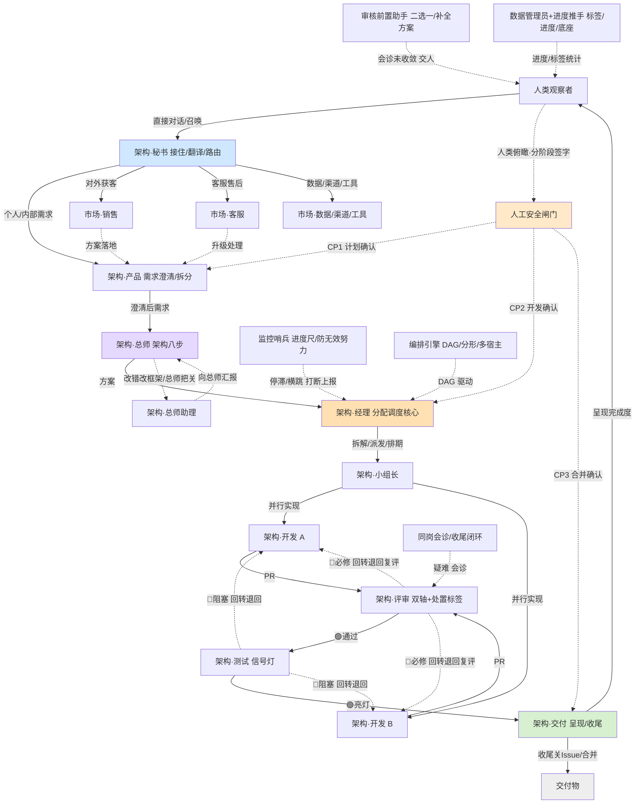

# 🏗️ 架构师 Agent（dongjiagoushi）

以 **AI 优先、人类俯瞰、主动规避风险** 为核心设计理念的架构师 Agent 框架。

> ⚠️ **这「不是」单架构师控制体系。** 我们早已升级为 **多角色协作流水线**：
> 一套有**流程（DAG 非直线）、有互相调用（接力/触发/回转/打断）、有协作规则**的 NPC 团队。
> 「架构师」只是团队中的**一个核心角色**，由官方 `@CodeBuddy` 化身、零积分执行；
> 真正把需求从澄清推向交付的，是 **秘书入口 → 产品 → 总师 → 经理 → 开发小组 → 评审 → 测试 → 交付**
> 这条链上各角色的**接力协作**（详见下方「架构拓扑：协作主图」与「协作过程」）。

---

## 快速开始

在任意 Issue / PR 评论中召唤官方 `@CodeBuddy` 并提及架构师 skill：

```
@CodeBuddy 调用 architect skill，做 <某系统/模块> 的架构设计
```

`@CodeBuddy` 会自动加载 `.codebuddy/skills/architect/SKILL.md`，化身「架构师」，走**架构八步**：

**调研 → 顶层架构拓扑 → 可行性验证 → 工程实施方案 → 分工与协作规则 → 进度对齐 → 索引建立 → 汇报与复盘**

每步产出可核验交付物，并在 Issue/PR 留痕；关键节点有 ⏸CP1/⏸CP2/⏸CP3 暂停确认点，人类批准才放行。

## 在其他仓库使用架构师团队

架构师团队是本仓库定义的 NPC 团队，可在**组织内任意仓库**使用。

### 快速启用：Star 本仓库

在任意仓库的 Issue / PR 评论中 `@` 架构师团队前，先在 **本仓库页面** 点击 **Star** 按钮（关注本仓库）。
Star 后，本仓库定义的全部架构师 NPC 角色会自动出现在其他仓库的 `@` 选择器中：

```text
@dongdongxiaozu/dongjiagoushi(架构·秘书)  帮我处理这个需求
@dongdongxiaozu/dongjiagoushi(架构·产品)  澄清一下需求边界
@dongdongxiaozu/dongjiagoushi(架构·总师)  做架构设计
@dongdongxiaozu/dongjiagoushi(架构·开发)  实现这个功能
```

> **组织内所有成员**：每个成员都需要 Star 本仓库，才能在各自账号的 `@` 选择器中看到架构师团队。

### 不 Star 也能用：完整路径 @

不 Star 也可以使用，只需在评论中输入完整路径 `@dongdongxiaozu/dongjiagoushi(角色名)` 即可唤醒对应 NPC。

### 默认入口：架构·秘书

`@dongdongxiaozu/dongjiagoushi` 不指定角色时，默认由 **架构·秘书** 接住诉求——
秘书接收需求、翻译意图，并路由到架构·产品/架构·经理/架构·总师等对应角色。

### NPC 角色清单

| 角色 | 职责 |
|------|------|
| 架构·秘书 | 默认入口，需求接收与路由 |
| 架构·总师 | 架构八步设计核心 |
| 架构·产品 | 需求澄清与拆分 |
| 架构·经理 | 分配调度核心 |
| 架构·开发 | 需求驱动开发 |
| 架构·评审 | 代码质量守门员 |
| 架构·测试 | 质量验收 |
| 架构·交付 | 全流程呈现与收尾 |
| 更多角色 | 详见下方「架构·」前缀角色 |

### 协作过程速览（不是单线压给架构师，而是链式接力 + 并行 + 可打回）

> 速览先讲**流程**，各角色职责见上方「NPC 角色清单」，整张接力与管控图见下方「架构拓扑：协作主图」。

同一份需求从接住到交付，走**有流程、互相调用、可回退**的协作：

```text
[入口]  架构·秘书 —— 接住诉求 / 翻译意图 / 路由（个人需求→产品，获客→市场·销售 …）
   ↓  [接力卡: 触发] + 等下游 [接单] 回执才闭环
[澄清]  架构·产品 —— 需求澄清 / 拆需求（明确做 / 不做 / 验收标准）
   ↓
[设计]  架构·总师 —— 架构八步产出方案；涉及大改由「架构·总师助理」改错改框架
   ↓
[调度]  架构·经理 —— 拆任务 / 派角色 / 排期；锁 L4「接单→开工→交付」，不以"分了"为终点
   ↓  依赖满足即并行（DAG，不等上一环全完成）
[实现]  开发小组 = 架构·小组长(拆解/整合) + N 个开发(并行实现，可分形多小组)
   ↓  每个 PR 独立成分支；客观验证器裁定是否合格（开发不自判"我完成了"）
[质量]  架构·评审 —— 双轴(规范轴+Spec轴) + 统一处置标签；🔴必修 → [回转]退回开发复评
       架构·测试 —— 信号灯亮起才放行
   ↓  🟢 通过
[呈现]  架构·交付 —— 全流程完成度呈现给人类，人确认后收尾（提交PR/关Issue/合并）
```

**贯穿全程的「互相调用 / 协作规则」（不看会误以为单架构师控制）：**

- **默认入口强制**：直接对话必先进「架构·秘书」接收→翻译→路由留痕，才可进入对应角色（即使显式 `@` 也须秘书先接收）。
- **三层触发**：显式 `[触发:<角色全称>]` / 语义命中职责域 / `AGENTS.md` 固定 rules 兜底——角色不是"纸面协作"，而是被硬触发。
- **回转（打回）**：下游发现不达标须 `[回转] 退回:<角色> / 原因 / 下一步要求`，被打回角色返工交回复评，最多 3 次超次标 `blocked` 上报。
- **打断（续跑）**：中断发 `[打断]` 并留续跑点，续跑凭进度无缝接续，不重做已完成。
- **真实唤醒校验**：派发方派完必须校验对端是否真回执 `[接单]`，列清单 ≠ 完成（锁 L4 开工交付）。
- **哨兵防无效努力**：目标进度尺量化距离，命中「停滞/横跳/重复错误」即打断重规划 / 上报。
- **审核者前置助手 / 同岗会诊**：A/B 二选一都不够好、会诊未收敛时补全被忽略方案，能自决自决、要担责结果前置交人。

---

## 设计理念

| 理念 | 落地 |
|------|------|
| **AI 优先** | 产出结构化、条理、全面、可索引；可跟踪日志、失败可回溯、可接力续跑 |
| **人类俯瞰** | 二级信息（状态汇总+风险+决策摘要+索引）、可视化看板、进度对齐 |
| **主动规避风险** | 风险显式暴露 + 规避方案；暂停确认点由人把关；承担风险的是人类 |
| **模块化** | 角色/偏好注入/流程编排/观测决策/安全护栏/知识库 六模块独立演进 |
| **完整不残次** | 拒绝最小可行骨架，半成品是污染源 |

---

## 目录结构

```
.
├── .cnb/
│   └── settings.yml                     # 角色骨架：架构师为主 + PM/DEV/CR/QA 完整可执行人设（含三层触发 + 回转/打断协议）
├── .cnb.yml                             # 流水线：知识库入库 + npc:go 兜底 + codewiki
├── .codebuddy/
│   └── skills/
│       └── architect/
│           └── SKILL.md                 # ⭐ 架构师方法论（官方 @CodeBuddy 自动加载）
├── tests/
│   ├── test_architect_system.sh         # ⭐ 测试信号灯（静态断言：五项关键链路，test 阶段执行）
│   ├── test_functional_links.sh         # ⭐ 真实功能链路测试（数据获取/看板呈现/RAG读取 真跑通）
│   ├── test_relay_workflow.sh           # ⭐ 接力链路可复现测试（T8 端到端：接力卡/回转/打断/三层触发）
│   └── test_memory_store.sh             # ⭐ 经验记忆库+语义向量触发+双后端兼容测试（T9）
├── src/
│   └── memory/                          # ⭐ 经验记忆库 + 语义向量触发引擎（LanceDB/云端双兼容 + 持续积累经验）
├── AGENTS.md                            # 全局协作规则
├── docs/
│   ├── ARCHITECTURE.md                  # 顶层架构拓扑
│   ├── ROADMAP.md                       # 工程实践路线图
│   ├── DASHBOARD.md                     # 📊 可视化看板（自动化生成，勿手编）
│   ├── ISSUE_MANAGEMENT.md              # Issue 声明与模块版本管理机制
│   ├── HYBRID_RESOURCE.md               # 🌐 Hybrid 混合资源路由（云端 CPU 本地化，Issue #57 + v1.1 跑通记录）
│   ├── HYBRID_CI_BUS.md                 # 🚌 云端 CI 整批测试执行（BusRunner 接入 CI · Issue #93）
│   ├── CLOUD_LOCAL_COOP.md              # ☁️🖥️ 云端⇄本地协同机制（分工边界/触发时机/异常处理，Issue #90）
│   ├── PLATFORM_ADAPTERS.md             # 跨宿主适配方案（cnb.cool / deepseek harness / MCP）
│   └── templates/
│       ├── architect-report.md          # 架构八步产物模板
│       ├── issue-template.md            # Issue 结构化声明模板
│       └── acceptance-checklist.md      # 测试验收清单（信号灯）
├── scripts/
│   └── generate-dashboard.py            # 🚀 看板自动生成器
├── local-agent/                         # 🚀 本地 Agent 团队（无 @ 环境，需求→交付自动编排）
│   ├── run.py                           # 本地入口：--role / --pipeline / --resume / --scale
│   ├── team.yaml                        # 团队角色 + DAG 流水线定义（含秘书入口 + 分形开发节点）
│   ├── orchestrator.py                  # 编排引擎（DAG 调度 + 分形执行，需求→交付）
│   ├── graph.py                         # 🆕 DAG 引擎（拓扑排序 + 并行波次，非直线）
│   ├── fractal.py                       # 🆕 分形扩展引擎（开发多小组并行 + 整合）
│   ├── scale/                           # 🆕🚀 规模伸缩层（架构升级：可伸缩蜂群协作平台）
│   │   ├── spec.py                      #   团队规模/分工层级/并发度声明 + 资源评估
│   │   ├── profile.py                   #   前置流程区分（不同位置不同流程模板）
│   │   ├── plugin.py                    #   角色插件化注册（灵活增减角色的规则支撑）
│   │   ├── broker.py                    #   agent 间消息总线（发布/订阅/定向/广播）
│   │   ├── store.py                     #   按 agent 分片的状态存储（替代单文件接力卡）
│   │   ├── pool.py                      #   并发执行池（真并行波次，支持大规模并发模拟）
│   │   └── engine.py                    #   统一调度引擎（整合以上，规模化流水线）
│   ├── engine/                         # 🆕🚀 上位机 · 定时器+状态机工程能力引擎（见 docs/HOST_ENGINE.md）
│   │   ├── state_machine.py            #   状态机：合法转移表 + 强制校验 + 留痕（机器角色生命周期）
│   │   ├── timer.py                    #   定时器：周期/一次性任务 + 超时检测 + 心跳巡检
│   │   ├── host.py                     #   上位机运行内核（统一管理各机器角色状态与时序）
│   │   └── cli.py                      #   CLI：demo / transitions / state
│   ├── data/                            # 🆕🚀 数据管理层（数据库承载：内容存档/进度统计/消息管线/任务存储）
│   │   ├── __init__.py                  #   统一入口（db/schema/repository/admin）
│   │   ├── db.py                        #   数据库连接层 + 后端抽象（SQLite 默认零依赖 / PostgreSQL 可选）
│   │   ├── schema.py                    #   20 张数据表 DDL（六表 + collab 五表 + 一等实体三表 + 哨兵两表 + ops 四表）
│   │   ├── repository.py                #   各表统一 CRUD（屏蔽后端差异）
│   │   ├── admin.py                     #   ⭐ 数据管理员职责执行（内容存档/进度统计/消息管线/任务存储）
│   │   └── cli.py                       #   命令行入口
│   ├── collab/                          # 🆕🚀 协作运作 + 同岗协作收尾闭环（会诊→审核者前置→人类）
│   │   ├── engine.py                    #   协作运作引擎（实体解耦/空间/ACL/版本/小组提交）
│   │   ├── peer.py                      #   同岗位多角色交互（cohort/触发门控/专家会诊/扩容/分形）
│   │   ├── precursor.py                 #   E1 审核者前置助手（L1内部分支→L2外部探索→L3交人+⑤自决）
│   │   ├── decisions.py                 #   E3 决策落库 + 动作消费（驱动改道/补位/升级/交人）
│   │   ├── human_gate.py                #   E4 结果前置·人类拍板（决策点叫人类 + CP 留痕）
│   │   └── closure.py                   #   收尾闭环统一编排（会诊未收敛→前置→人类 全自动）
│   ├── sentinel/                        # 🆕🚀 防无效努力 · 目标收敛监控（量化距离 → 判定 → 打断/上报）
│   │   ├── store.py                     #   目标进度尺(goal_meters) + 监控动作(sentinel_actions) 数据访问
│   │   ├── detect.py                    #   无效努力判定（停滞/横跳/重复错误/进度上限停滞 progress_cap_stall）
│   │   ├── engine.py                    #   处置协议（track → 1级打断重规划 / 2级上报局部调整）
│   │   └── peer_guard.py                #   E2 同岗协作组（cohort）收敛监控
│   ├── dispatcher/                      # 🆕🚀 调度中枢 · 事件驱动自动化调度（见 docs/DISPATCHER.md）
│   │   ├── source.py                    #   事件源监听 + 外部适配器插槽（本仓库+外部，通用解决）
│   │   ├── rules.py                     #   触发规则引擎（岗位/审核/驳回/遗漏，自动优先/规则优先）
│   │   ├── queue.py                     #   Action 队列（自动放行+人工审核闸门，不卡进程）
│   │   ├── guard.py                     #   防无效护栏（去重/频限/进度上限，联动哨兵）
│   │   ├── router.py                    #   路由派发器（按 gid 精准定位负责 agent）
│   │   ├── reject.py                    #   驳回迭代表（驳回非终点，按 gid 回派改进重提）
│   │   ├── engine.py                    #   统一调度引擎（scan / --watch 持续守护）
│   │   ├── webui.py                     #   Web 可视化面板（事件流/路由/拦截/驳回/哨兵/进度尺/外部源）
│   │   ├── cli.py                       #   CLI：scan / watch / web / overview / reject / ext / webhook / host
│   │   ├── security.py                  #   🆕 外部源安全：秘钥 key + IP 白名单 + 认证审计（见 docs/EXTERNAL_SOURCE.md）
│   │   ├── webhook.py                   #   🆕 多源 Webhook 接收端（POST /webhook/<source>，本地/手机/虚拟机/沙盒/上位机）
│   │   ├── sources.py                   #   🆕 多源适配器注册 + 本地电脑适配器（云端-本地协同）
│   │   └── host_helper.py               #   🆕 本地上位机辅助角色（预设功能，之后接入真实上位机）
│   ├── topology/                        # 🆕 拓扑对比框架 + 融合拓扑规则引擎（见 docs/TOPOLOGY_COMPARISON.md / docs/FUSION_TOPOLOGY.md）
│   │   ├── topologies.py                  #   7 条拓扑线路定义（linear/dag/event/hybrid/scatter/agile/prefix）
│   │   ├── fusion.py                      #   🆕 融合拓扑规则引擎（规模金字塔→承接体系：agile/architected/company/full，缓存命中为主线）
│   │   ├── metrics.py                     #   全维度对比指标收集与持久化（并发/速度/完成度/bug/token/文件/agent/资源）
│   │   ├── metrics.py                     #   全维度对比指标收集与持久化（并发/速度/完成度/bug/token/文件/agent/资源）
│   │   ├── resource.py                    #   🆕 资源消耗监控（CPU/内存/网络/文件，零第三方依赖）
│   │   ├── tasksource.py                  #   🆕 真实任务源（架构完未分配/经理分工未触发的真实待办）
│   │   ├── runner.py                      #   基础对比执行器 CLI（同一需求跑不同拓扑）
│   │   ├── benchmark.py                   #   🆕 增强AB隔离对比执行器（真实任务+全维度+资源监控）
│   │   ├── prefix_cache.py                #   🆕 前缀缓存聚合（共享提示词前缀/缓存命中索引/水龙头蔓延，降token降bug）
│   │   └── cache_monitor.py               #   🆕 缓存命中监控（按 agent 量化效果/浪费判定，见 docs/CACHE_MONITOR.md）
│   ├── dispatch_engine.py              # 🆕 经理四层分发深度引擎（L1声明→L2分发→L3触发→L3.5接单→L4工作交付，验收口径=走到L4，见 docs/DISPATCH_DEPTH.md）
│   ├── dispatch/                        # 🆕 通用派发能力包（派发工作全员化 · 可复用模块，见 docs/DISPATCH_ABILITY.md）
│   │   ├── ability.py                   #   DispatchAbility 通用能力类（全员可派发 L1→L4 + 可接单[接单]/进度尺/交付）
│   │   └── __init__.py                  #   导出 DispatchAbility（默认挂载到 BaseRole，所有角色具备）
│   ├── handle/                          # 🆕 自适应 @ 定位能力包（不写死角色名/跨库权限，见 docs/HANDLE_ABILITY.md）
│   │   ├── resolver.py                  #   核心解析器：触发串识别/仓库探测/跨同仓判定/权限建议
│   │   ├── ability.py                   #   HandleAbility 能力类（self_handle/resolve/is_cross）
│   │   └── __init__.py                  #   导出 HandleAbility（默认挂载到 BaseRole，所有角色具备）
│   ├── galton/                            # 🆕 高尔顿板 MVP 原型（Router+3Worker+1Aggregator 球路由→加工→合并闭环，见 docs/GALTON.md）
│   │   ├── engine.sh                    #   Bash 核心引擎（沙盒可直接验证）
│   │   ├── engine.py                    #   Python 等价实现（云 CI / 真实环境）
│   │   └── __init__.py                  #   模块接口导出
│   ├── roles.d/                         # 🆕 角色插件目录（放一个 .py 即自动加载新角色）
│   │   └── analyst.py                   #   插件角色示例（架构·数据分析师）
│   ├── roles/                           # 25 个角色模块（秘书/产品/总师/总师助理/经理/小组长/开发/评审/对齐/找工具/测试/数据管理员/监控哨兵 + 市场层5 + 公司化三战线7）
│   └── llm/                             # 多模型后端抽象（OpenAI 兼容/CLI 兜底占位）
│       └── cache.py                     #   🆕 LLM 层 context caching（缓存头透传 + generate() 修复 + 命中监控）
├── docs/
│   └── FRAMEWORK_V2.md                  # 🆕 体系五维增强架构设计（DAG/分形/市场分层/入口路由/多宿主）
│   └── PLATFORM_ADAPTERS.md             # 🆕 跨平台适配方案（cnb.cool / deepseek harness / MCP 蜂群）
└── README.md                            # 本文件
```

---

## 架构拓扑

### 协作主图（有流程 · 互相调用 · 非单架构师控制）

下图把**入口路由、主线研发 DAG、质量闸门、横向协作机制、人类俯瞰/安全闸门**合并到一张图（各角色职责见上方「NPC 角色清单」，链式流程见「协作过程速览」）——
它能解释"为什么不是单架构师控制"：角色之间靠接力互相调用、DAG 并行、可回转打回、全程有哨兵与数据底座托底。

> **安全闸门分阶段签字（不是只在产品段卡一次人）**：人类俯瞰贯穿全程，但只在**关键节点**签字拍板——
> ⏸**CP1 计划确认**（产品澄清/总师出方案前，落到 `PROD`）、⏸**CP2 开发确认**（经理调度/开发实现中，落到 `MGR`）、
> ⏸**CP3 合并确认**（交付收尾/关 Issue 合并前，落到 `DEL`）。低中风险走 AI 自动+错了就改，高风险才由人类把关。



---

## 核心机制

1. **零积分架构师**：官方 `@CodeBuddy` 化身，由 skill 自动加载方法论，不扣积分。
2. **一库多角色**：单仓共享架构/流水线/知识库，接力卡稳定传上下文，目标不偏差。
3. **知识库 RAG**：`knowledge:update` 入库（`hunyuan` embedding），架构师读信息条理全面。
4. **Code Wiki**：打 tag 自动生成 Wiki 并入库，可被 AI 问答引用。
5. **Issue 版本管理**：每个 Issue 声明所属模块/类型/目标/版本/更新内容，形成模块能力演进线，可阶段性多次加强（见 [docs/ISSUE_MANAGEMENT.md](docs/ISSUE_MANAGEMENT.md)）。
6. **测试信号灯（护栏）**：`.cnb.yml` 的 test 阶段依次执行四个脚本——`tests/test_architect_system.sh`（静态断言：skill 触发/八步产物/CP 护栏/知识库配置/多角色接力/触发强制化/回转打断）、`tests/test_functional_links.sh`（**真实功能链路**：真实拉取 Issue 数据、真实生成看板、真实查询 RAG）、`tests/test_relay_workflow.sh`（**接力链路可复现**：接力卡传递/回转打回/中断续跑/三层触发）与 `tests/test_memory_store.sh`（**经验记忆库+语义向量触发**：真实向量检索触发 + LanceDB/云端双兼容 + 持续积累经验）——**功能未真正跑通即红灯阻塞，不放行**（见 [docs/templates/acceptance-checklist.md](docs/templates/acceptance-checklist.md)）。
6b. **协作触发强制化 + 回转/打断协议**：协作角色由三层机制强制触发（显式 `[触发]` 声明 / 语义向量命中 / `AGENTS.md` rules 固定兜底），非纸面说明；接力可 `[回转]` 打回重做、`[打断]` 中断续跑（T8 可复现）。详见 `AGENTS.md`/`SKILL.md`/`settings.yml`。
6c. **经验记忆库 + 语义向量触发（专业可靠）**：语义向量触发从 prompt/关键词层面升级为**真实向量检索**——`src/memory/` 提供统一向量格式 + LanceDB 本地持久化 + 云端 CNB 知识库同格式适配（双后端兼容）+ 持续积累经验 + 语义向量触发引擎（T9 可复现）。详见 [docs/MEMORY.md](docs/MEMORY.md)。
7. **角色命名风格化**：本体系所有可 `@` 触发的角色统一加「架构·」前缀（架构·总师/产品/开发/评审/测试），与其他团队 agent 区分不重名；`@` 输入「架构」即自动填充补全整套团队。`架构师` 保留为体系品牌与 Skill 化身身份。
8. **安全护栏**：CP1/CP2/CP3 暂停确认 + 敏感信息红线 + 风险显式暴露。
9. **可视化看板自动化**：基于 Issue 声明头自动汇总模块版本演进看板 + 里程碑表，人类俯瞰决策看 [docs/DASHBOARD.md](docs/DASHBOARD.md)（由 `scripts/generate-dashboard.py` 在 Issue 增改删时自动刷新）。
10. **本地 Agent 团队**：在无 `@` 的本地环境用 CLI 补齐云端触发能力，形成「**产品沟通→架构设计→经理调度→协同→测试→交付**」三核心协作闭环（产品沟通为开始 / 架构师为设计核心 / 经理为分配调度核心）。详见 [local-agent/README.md](local-agent/README.md) 与 [docs/LOCAL_AGENT.md](docs/LOCAL_AGENT.md) 与 [docs/FRAMEWORK_SHELL.md](docs/FRAMEWORK_SHELL.md)。
    ```bash
    cd local-agent && pip install -r requirements.txt
    python3 run.py --pipeline full --req "做一个订单系统"   # 一键团队流水线到交付
    ```
11. **DAG 流水线（非直线）+ 分形开发 + 入口路由 + 市场分层 + 多宿主适配**：
    - **DAG 工作流**：团队流水线从直线升级为**有向无环图（DAG）**，依赖满足即并行——架构·总师给出架构方案后，**架构·经理即可提前分工**（不必等开发完成），下游对齐/找工具/小组长可与实现并行（`local-agent/graph.py` + `team.yaml` 的 `dag`）。
    - **开发分形扩展**：开发任务按项目规模分形为多个小组并行，小组长整合测试后**统一向上交付**，可递归（`local-agent/fractal.py`）。
    - **默认入口**：一开始直接对话默认进「架构·秘书」接住诉求、翻译意图、路由到对应角色（个人需求→产品，获客→销售…）；到其他身份用 `@CodeBuddy` 主动触发切换。
    - **市场获客分层**：工具/数据/渠道/客服/销售 为平台级通用基建，服务对外获客 + 对内需求（`roles/market.py`）。
    - **多宿主适配**：统一活动规则 + 适配 cnb.cool / deepseek harness / MCP 蜂群（`docs/PLATFORM_ADAPTERS.md`）。
    详见 [docs/FRAMEWORK_V2.md](docs/FRAMEWORK_V2.md)（体系五维增强架构设计）。
12. **可伸缩蜂群协作平台（规模伸缩层 scale）**：架构升级，支撑**上百/上千/2500 级**并发协作：
    - **团队规模声明**：`--spec '{"team_size":2500,"levels":3,"mode":"harness"}'` 声明团队大小、分工层级、并发度，并自动生成分工拓扑 + 资源评估（超单机上限会提示升级分布式后端）。
    - **前置流程区分**：不同"位置"走不同流程模板——`default`（个人需求）/`company`（在线公司多部门）/`harness`（deepseek 内嵌）/`acquisition`（对外获客）/`support`（客服售后）。
    - **角色插件化**：在 `roles.d/` 放一个继承 `BaseRole` 的 `.py` 即自动加载新角色（灵活增减，无需改核心代码）。
    - **消息总线 + 状态分片 + 并发池**：agent 间发布/订阅消息、按 agent 分片状态（替代单文件接力卡）、真并行波次执行。
    ```bash
    cd local-agent && python3 run.py --scale --profile harness \
      --spec '{"team_size":100,"levels":3}' --req "做一个高并发系统"
    python3 run.py --list-profiles   # 查看前置流程模板
    python3 run.py --list-roles      # 查看角色（含插件）
    ```
    详见 [docs/FRAMEWORK_V3.md](docs/FRAMEWORK_V3.md)（架构升级设计）。
13. **解耦式功能模块开发（按功能分布 · 防冲突 · 跨项目可复用）**：每个功能模块**独立成 PR、base 一律 `main`**，禁止把新模块 base 挂到其他功能分支上（避免 #29/#30 耦合冲突教训）；按功能域解耦、接口显式化、开 PR 前 `merge-tree` 校验与 `main` 无冲突、每个 PR 自含测试+文档。评审在 PR 层面核验五条，任一不满足即打回（详见 AGENTS.md「解耦式功能模块开发」固定规则 + [docs/ISSUE_MANAGEMENT.md](docs/ISSUE_MANAGEMENT.md) 第八节）。
14. **协作治理机制群（这就是"不是单架构师控制"的那部分，以前散在 AGENTS.md 没在图里显示）**：
    - **派发递进深度（L1→L4）**：派活不是"分了就完事"，锁最深层——角色**接单后继续工作到交付**（L4）；经理判定派发只到 L2/L3 不算完成。
    - **七层协作深度（DepthAbility）**：协作从"表述"推到"真实唤醒+持续到结果"；路由必须校验对端回执 `[接单]`（awake），防"只描述没唤醒"。
    - **派发能力全员化 + 真实唤醒校验**：任意角色可在自己职责域内派发子任务、全员可接单；派发完必须 `dispatch_verify()` 校验对端真实回执，列清单 ≠ 完成。
    - **同岗多角色交互（peer collab）**：默认单兵、按需补位、疑难才专家会诊；会诊未收敛走审核者前置 → 结果前置交人。
    - **标签 + 进度自动化（LabelAbility）**：进度/标签全员程序化读写，事件驱动自动打标（open→in_progress→done→merged…），进度推手翻译成百分比，CI 自动打标。
    - **评审双轴 + 统一处置标签 + 有效性度量**：评审必走「规范轴+Spec轴」双轴并行、缺轴不放行；结论一律规范处置标签（merge/proceed/fix_bug/research/human/consult/vote/blocked）驱动自动路由；有效性按 5 维 × 概率×程度分档量化留痕。
    - **监控哨兵防无效努力**：目标进度尺量化到北极星的剩余距离，机器判定停滞/横跳/重复错误，1 级打断重规划、2 级上报局部调整。
    - **秘书层动态扩展 / 审核者前置助手**：秘书识别/注册/路由动态增减，只交接不执行；A/B 都不够好时补全被忽略方案，能自决自决、要担责结果前置。
    - 全部协作治理机制的**唯一索引**见 [docs/CAPABILITY_INDEX.md](docs/CAPABILITY_INDEX.md)。

---

## 常见命令

- 召唤架构师：`@CodeBuddy 调用 architect skill，<需求>`
- 查看知识库状态：仓库「知识库」入口
- 查看进度看板：`docs/DASHBOARD.md`（Issue 增改删时自动刷新，也可 `python3 scripts/generate-dashboard.py` 手动刷新）
- 生成/更新 Wiki：打 tag（触发 `tag_push` → codewiki）

详细请见 [docs/ARCHITECTURE.md](docs/ARCHITECTURE.md) 与 [docs/ROADMAP.md](docs/ROADMAP.md)。
