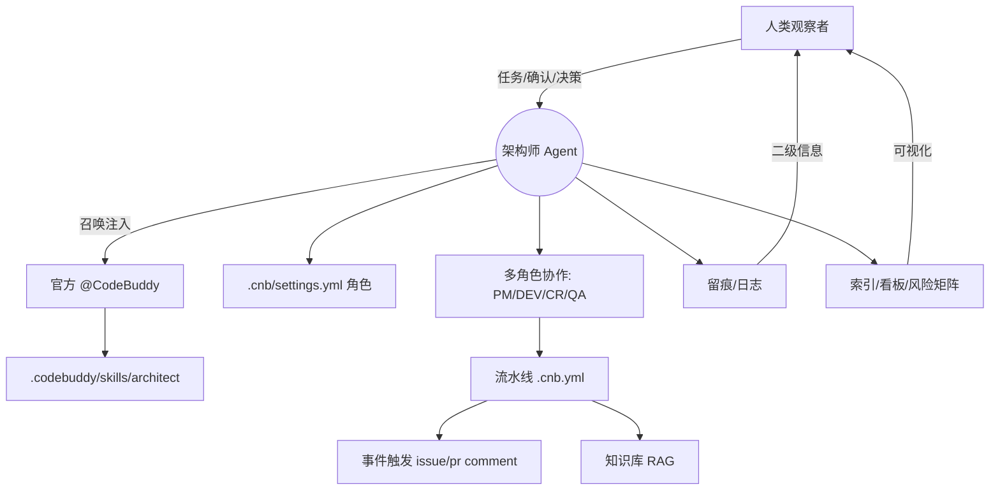

# 🏗️ 架构师 Agent（dongjiagoushi）

以 **AI 优先、人类俯瞰、主动规避风险** 为核心设计理念的架构师 Agent 框架。
由官方免费 `@CodeBuddy` 化身「架构师」，零积分执行，走一条完整的模块化工程实践路线。

---

## 快速开始

在任意 Issue / PR 评论中召唤官方 `@CodeBuddy` 并提及架构师 skill：

```
@CodeBuddy 调用 architect skill，做 <某系统/模块> 的架构设计
```

`@CodeBuddy` 会自动加载 `.codebuddy/skills/architect/SKILL.md`，化身「架构师」，走**架构八步**：

**调研 → 顶层架构拓扑 → 可行性验证 → 工程实施方案 → 分工与协作规则 → 进度对齐 → 索引建立 → 汇报与复盘**

每步产出可核验交付物，并在 Issue/PR 留痕；关键节点有 ⏸CP1/⏸CP2/⏸CP3 暂停确认点，人类批准才放行。

---

## 设计理念

| 理念 | 落地 |
|------|------|
| **AI 优先** | 产出结构化、条理、全面、可索引；可跟踪日志、失败可回溯、可接力续跑 |
| **人类俯瞰** | 二级信息（状态汇总+风险+决策摘要+索引）、可视化看板、进度对齐 |
| **主动规避风险** | 风险显式暴露 + 规避方案；暂停确认点由人把关；承担风险的是人类 |
| **模块化** | 角色/偏好注入/流程编排/观测决策/安全护栏/知识库 六模块独立演进 |
| **完整不残次** | 拒绝最小可行骨架，半成品是污染源 |

---

## 目录结构

```
.
├── .cnb/
│   └── settings.yml                     # 角色骨架：架构师为主 + PM/DEV/CR/QA 完整可执行人设（含三层触发 + 回转/打断协议）
├── .cnb.yml                             # 流水线：知识库入库 + npc:go 兜底 + codewiki
├── .codebuddy/
│   └── skills/
│       └── architect/
│           └── SKILL.md                 # ⭐ 架构师方法论（官方 @CodeBuddy 自动加载）
├── tests/
│   ├── test_architect_system.sh         # ⭐ 测试信号灯（静态断言：五项关键链路，test 阶段执行）
│   ├── test_functional_links.sh         # ⭐ 真实功能链路测试（数据获取/看板呈现/RAG读取 真跑通）
│   ├── test_relay_workflow.sh           # ⭐ 接力链路可复现测试（T8 端到端：接力卡/回转/打断/三层触发）
│   └── test_memory_store.sh             # ⭐ 经验记忆库+语义向量触发+双后端兼容测试（T9）
├── src/
│   └── memory/                          # ⭐ 经验记忆库 + 语义向量触发引擎（LanceDB/云端双兼容 + 持续积累经验）
├── AGENTS.md                            # 全局协作规则
├── docs/
│   ├── ARCHITECTURE.md                  # 顶层架构拓扑
│   ├── ROADMAP.md                       # 工程实践路线图
│   ├── DASHBOARD.md                     # 📊 可视化看板（自动化生成，勿手编）
│   ├── ISSUE_MANAGEMENT.md              # Issue 声明与模块版本管理机制
│   └── templates/
│       ├── architect-report.md          # 架构八步产物模板
│       ├── issue-template.md            # Issue 结构化声明模板
│       └── acceptance-checklist.md      # 测试验收清单（信号灯）
├── scripts/
│   └── generate-dashboard.py            # 🚀 看板自动生成器
├── local-agent/                         # 🚀 本地 Agent 团队（无 @ 环境，需求→交付自动编排）
│   ├── run.py                           # 本地入口：--role / --pipeline / --resume / --scale
│   ├── team.yaml                        # 团队角色 + DAG 流水线定义（含秘书入口 + 分形开发节点）
│   ├── orchestrator.py                  # 编排引擎（DAG 调度 + 分形执行，需求→交付）
│   ├── graph.py                         # 🆕 DAG 引擎（拓扑排序 + 并行波次，非直线）
│   ├── fractal.py                       # 🆕 分形扩展引擎（开发多小组并行 + 整合）
│   ├── scale/                           # 🆕🚀 规模伸缩层（架构升级：可伸缩蜂群协作平台）
│   │   ├── spec.py                      #   团队规模/分工层级/并发度声明 + 资源评估
│   │   ├── profile.py                   #   前置流程区分（不同位置不同流程模板）
│   │   ├── plugin.py                    #   角色插件化注册（灵活增减角色的规则支撑）
│   │   ├── broker.py                    #   agent 间消息总线（发布/订阅/定向/广播）
│   │   ├── store.py                     #   按 agent 分片的状态存储（替代单文件接力卡）
│   │   ├── pool.py                      #   并发执行池（真并行波次，支持大规模并发模拟）
│   │   └── engine.py                    #   统一调度引擎（整合以上，规模化流水线）
│   ├── engine/                         # 🆕🚀 上位机 · 定时器+状态机工程能力引擎（见 docs/HOST_ENGINE.md）
│   │   ├── state_machine.py            #   状态机：合法转移表 + 强制校验 + 留痕（机器角色生命周期）
│   │   ├── timer.py                    #   定时器：周期/一次性任务 + 超时检测 + 心跳巡检
│   │   ├── host.py                     #   上位机运行内核（统一管理各机器角色状态与时序）
│   │   └── cli.py                      #   CLI：demo / transitions / state
│   ├── data/                            # 🆕🚀 数据管理层（数据库承载：内容存档/进度统计/消息管线/任务存储）
│   │   ├── __init__.py                  #   统一入口（db/schema/repository/admin）
│   │   ├── db.py                        #   数据库连接层 + 后端抽象（SQLite 默认零依赖 / PostgreSQL 可选）
│   │   ├── schema.py                    #   6 张数据表 DDL（agents/messages/tasks/progress/archives/stats）
│   │   ├── repository.py                #   各表统一 CRUD（屏蔽后端差异）
│   │   ├── admin.py                     #   ⭐ 数据管理员职责执行（内容存档/进度统计/消息管线/任务存储）
│   │   └── cli.py                       #   命令行入口
│   ├── roles.d/                         # 🆕 角色插件目录（放一个 .py 即自动加载新角色）
│   │   └── analyst.py                   #   插件角色示例（架构·数据分析师）
│   ├── roles/                           # 16 个角色模块（秘书/产品/总师/经理/小组长/开发/评审/对齐/找工具/测试/数据管理员 + 市场5角色）
│   └── llm/                             # 多模型后端抽象（OpenAI 兼容/CLI 兜底占位）
├── docs/
│   └── FRAMEWORK_V2.md                  # 🆕 体系五维增强架构设计（DAG/分形/市场分层/入口路由/多宿主）
│   └── PLATFORM_ADAPTERS.md             # 🆕 跨平台适配方案（cnb.cool / deepseek harness / MCP 蜂群）
└── README.md                            # 本文件
```

---

## 架构拓扑



---

## 核心机制

1. **零积分架构师**：官方 `@CodeBuddy` 化身，由 skill 自动加载方法论，不扣积分。
2. **一库多角色**：单仓共享架构/流水线/知识库，接力卡稳定传上下文，目标不偏差。
3. **知识库 RAG**：`knowledge:update` 入库（`hunyuan` embedding），架构师读信息条理全面。
4. **Code Wiki**：打 tag 自动生成 Wiki 并入库，可被 AI 问答引用。
5. **Issue 版本管理**：每个 Issue 声明所属模块/类型/目标/版本/更新内容，形成模块能力演进线，可阶段性多次加强（见 [docs/ISSUE_MANAGEMENT.md](docs/ISSUE_MANAGEMENT.md)）。
6. **测试信号灯（护栏）**：`.cnb.yml` 的 test 阶段依次执行四个脚本——`tests/test_architect_system.sh`（静态断言：skill 触发/八步产物/CP 护栏/知识库配置/多角色接力/触发强制化/回转打断）、`tests/test_functional_links.sh`（**真实功能链路**：真实拉取 Issue 数据、真实生成看板、真实查询 RAG）、`tests/test_relay_workflow.sh`（**接力链路可复现**：接力卡传递/回转打回/中断续跑/三层触发）与 `tests/test_memory_store.sh`（**经验记忆库+语义向量触发**：真实向量检索触发 + LanceDB/云端双兼容 + 持续积累经验）——**功能未真正跑通即红灯阻塞，不放行**（见 [docs/templates/acceptance-checklist.md](docs/templates/acceptance-checklist.md)）。
6b. **协作触发强制化 + 回转/打断协议**：协作角色由三层机制强制触发（显式 `[触发]` 声明 / 语义向量命中 / `AGENTS.md` rules 固定兜底），非纸面说明；接力可 `[回转]` 打回重做、`[打断]` 中断续跑（T8 可复现）。详见 `AGENTS.md`/`SKILL.md`/`settings.yml`。
6c. **经验记忆库 + 语义向量触发（专业可靠）**：语义向量触发从 prompt/关键词层面升级为**真实向量检索**——`src/memory/` 提供统一向量格式 + LanceDB 本地持久化 + 云端 CNB 知识库同格式适配（双后端兼容）+ 持续积累经验 + 语义向量触发引擎（T9 可复现）。详见 [docs/MEMORY.md](docs/MEMORY.md)。
7. **角色命名风格化**：本体系所有可 `@` 触发的角色统一加「架构·」前缀（架构·总师/产品/开发/评审/测试），与其他团队 agent 区分不重名；`@` 输入「架构」即自动填充补全整套团队。`架构师` 保留为体系品牌与 Skill 化身身份。
8. **安全护栏**：CP1/CP2/CP3 暂停确认 + 敏感信息红线 + 风险显式暴露。
9. **可视化看板自动化**：基于 Issue 声明头自动汇总模块版本演进看板 + 里程碑表，人类俯瞰决策看 [docs/DASHBOARD.md](docs/DASHBOARD.md)（由 `scripts/generate-dashboard.py` 在 Issue 增改删时自动刷新）。
10. **本地 Agent 团队**：在无 `@` 的本地环境用 CLI 补齐云端触发能力，形成「**产品沟通→架构设计→经理调度→协同→测试→交付**」三核心协作闭环（产品沟通为开始 / 架构师为设计核心 / 经理为分配调度核心）。详见 [local-agent/README.md](local-agent/README.md) 与 [docs/LOCAL_AGENT.md](docs/LOCAL_AGENT.md) 与 [docs/FRAMEWORK_SHELL.md](docs/FRAMEWORK_SHELL.md)。
    ```bash
    cd local-agent && pip install -r requirements.txt
    python3 run.py --pipeline full --req "做一个订单系统"   # 一键团队流水线到交付
    ```
11. **DAG 流水线（非直线）+ 分形开发 + 入口路由 + 市场分层 + 多宿主适配**：
    - **DAG 工作流**：团队流水线从直线升级为**有向无环图（DAG）**，依赖满足即并行——架构·总师给出架构方案后，**架构·经理即可提前分工**（不必等开发完成），下游对齐/找工具/小组长可与实现并行（`local-agent/graph.py` + `team.yaml` 的 `dag`）。
    - **开发分形扩展**：开发任务按项目规模分形为多个小组并行，小组长整合测试后**统一向上交付**，可递归（`local-agent/fractal.py`）。
    - **默认入口**：一开始直接对话默认进「架构·秘书」接住诉求、翻译意图、路由到对应角色（个人需求→产品，获客→销售…）；到其他身份用 `@CodeBuddy` 主动触发切换。
    - **市场获客分层**：工具/数据/渠道/客服/销售 为平台级通用基建，服务对外获客 + 对内需求（`roles/market.py`）。
    - **多宿主适配**：统一活动规则 + 适配 cnb.cool / deepseek harness / MCP 蜂群（`docs/PLATFORM_ADAPTERS.md`）。
    详见 [docs/FRAMEWORK_V2.md](docs/FRAMEWORK_V2.md)（体系五维增强架构设计）。
12. **可伸缩蜂群协作平台（规模伸缩层 scale）**：架构升级，支撑**上百/上千/2500 级**并发协作：
    - **团队规模声明**：`--spec '{"team_size":2500,"levels":3,"mode":"harness"}'` 声明团队大小、分工层级、并发度，并自动生成分工拓扑 + 资源评估（超单机上限会提示升级分布式后端）。
    - **前置流程区分**：不同"位置"走不同流程模板——`default`（个人需求）/`company`（在线公司多部门）/`harness`（deepseek 内嵌）/`acquisition`（对外获客）/`support`（客服售后）。
    - **角色插件化**：在 `roles.d/` 放一个继承 `BaseRole` 的 `.py` 即自动加载新角色（灵活增减，无需改核心代码）。
    - **消息总线 + 状态分片 + 并发池**：agent 间发布/订阅消息、按 agent 分片状态（替代单文件接力卡）、真并行波次执行。
    ```bash
    cd local-agent && python3 run.py --scale --profile harness \
      --spec '{"team_size":100,"levels":3}' --req "做一个高并发系统"
    python3 run.py --list-profiles   # 查看前置流程模板
    python3 run.py --list-roles      # 查看角色（含插件）
    ```
    详见 [docs/FRAMEWORK_V3.md](docs/FRAMEWORK_V3.md)（架构升级设计）。

---

## 常见命令

- 召唤架构师：`@CodeBuddy 调用 architect skill，<需求>`
- 查看知识库状态：仓库「知识库」入口
- 查看进度看板：`docs/DASHBOARD.md`（Issue 增改删时自动刷新，也可 `python3 scripts/generate-dashboard.py` 手动刷新）
- 生成/更新 Wiki：打 tag（触发 `tag_push` → codewiki）

详细请见 [docs/ARCHITECTURE.md](docs/ARCHITECTURE.md) 与 [docs/ROADMAP.md](docs/ROADMAP.md)。
