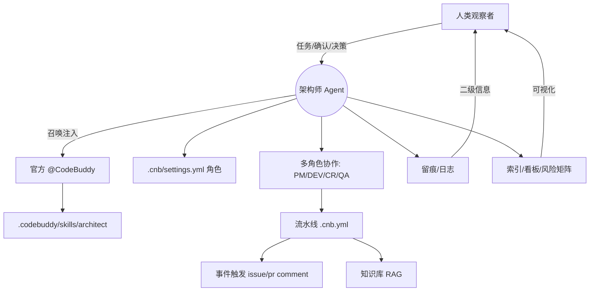

# 🏗️ 架构师 Agent（dongjiagoushi）

以 **AI 优先、人类俯瞰、主动规避风险** 为核心设计理念的架构师 Agent 框架。
由官方免费 `@CodeBuddy` 化身「架构师」，零积分执行，走一条完整的模块化工程实践路线。

---

## 快速开始

在任意 Issue / PR 评论中召唤官方 `@CodeBuddy` 并提及架构师 skill：

```
@CodeBuddy 调用 architect skill，做 <某系统/模块> 的架构设计
```

`@CodeBuddy` 会自动加载 `.codebuddy/skills/architect/SKILL.md`，化身「架构师」，走**架构八步**：

**调研 → 顶层架构拓扑 → 可行性验证 → 工程实施方案 → 分工与协作规则 → 进度对齐 → 索引建立 → 汇报与复盘**

每步产出可核验交付物，并在 Issue/PR 留痕；关键节点有 ⏸CP1/⏸CP2/⏸CP3 暂停确认点，人类批准才放行。

---

## 设计理念

| 理念 | 落地 |
|------|------|
| **AI 优先** | 产出结构化、条理、全面、可索引；可跟踪日志、失败可回溯、可接力续跑 |
| **人类俯瞰** | 二级信息（状态汇总+风险+决策摘要+索引）、可视化看板、进度对齐 |
| **主动规避风险** | 风险显式暴露 + 规避方案；暂停确认点由人把关；承担风险的是人类 |
| **模块化** | 角色/偏好注入/流程编排/观测决策/安全护栏/知识库 六模块独立演进 |
| **完整不残次** | 拒绝最小可行骨架，半成品是污染源 |

---

## 目录结构

```
.
├── .cnb/
│   └── settings.yml                     # 角色骨架：架构师为主 + PM/DEV/CR/QA 扩展位
├── .cnb.yml                             # 流水线：知识库入库 + npc:go 兜底 + codewiki
├── .codebuddy/
│   └── skills/
│       └── architect/
│           └── SKILL.md                 # ⭐ 架构师方法论（官方 @CodeBuddy 自动加载）
├── tests/
│   ├── test_architect_system.sh         # ⭐ 测试信号灯（静态断言：五项关键链路，test 阶段执行）
│   └── test_functional_links.sh         # ⭐ 真实功能链路测试（数据获取/看板呈现/RAG读取 真跑通）
├── AGENTS.md                            # 全局协作规则
├── docs/
│   ├── ARCHITECTURE.md                  # 顶层架构拓扑
│   ├── ROADMAP.md                       # 工程实践路线图
│   ├── DASHBOARD.md                     # 📊 可视化看板（自动化生成，勿手编）
│   ├── ISSUE_MANAGEMENT.md              # Issue 声明与模块版本管理机制
│   └── templates/
│       ├── architect-report.md          # 架构八步产物模板
│       ├── issue-template.md            # Issue 结构化声明模板
│       └── acceptance-checklist.md      # 测试验收清单（信号灯）
├── scripts/
│   └── generate-dashboard.py            # 🚀 看板自动生成器
└── README.md                            # 本文件
```

---

## 架构拓扑



---

## 核心机制

1. **零积分架构师**：官方 `@CodeBuddy` 化身，由 skill 自动加载方法论，不扣积分。
2. **一库多角色**：单仓共享架构/流水线/知识库，接力卡稳定传上下文，目标不偏差。
3. **知识库 RAG**：`knowledge:update` 入库（`hunyuan` embedding），架构师读信息条理全面。
4. **Code Wiki**：打 tag 自动生成 Wiki 并入库，可被 AI 问答引用。
5. **Issue 版本管理**：每个 Issue 声明所属模块/类型/目标/版本/更新内容，形成模块能力演进线，可阶段性多次加强（见 [docs/ISSUE_MANAGEMENT.md](docs/ISSUE_MANAGEMENT.md)）。
6. **测试信号灯（护栏）**：`.cnb.yml` 的 test 阶段依次执行两个脚本——`tests/test_architect_system.sh`（静态断言：skill 触发/八步产物/CP 护栏/知识库配置/多角色接力）与 `tests/test_functional_links.sh`（**真实功能链路**：真实拉取 Issue 数据、真实生成看板、真实查询 RAG）——**功能未真正跑通即红灯阻塞，不放行**（见 [docs/templates/acceptance-checklist.md](docs/templates/acceptance-checklist.md)）。
7. **角色命名风格化**：本体系所有可 `@` 触发的角色统一加「架构·」前缀（架构·总师/产品/开发/评审/测试），与其他团队 agent 区分不重名；`@` 输入「架构」即自动填充补全整套团队。`架构师` 保留为体系品牌与 Skill 化身身份。
8. **安全护栏**：CP1/CP2/CP3 暂停确认 + 敏感信息红线 + 风险显式暴露。
9. **可视化看板自动化**：基于 Issue 声明头自动汇总模块版本演进看板 + 里程碑表，人类俯瞰决策看 [docs/DASHBOARD.md](docs/DASHBOARD.md)（由 `scripts/generate-dashboard.py` 在 Issue 增改删时自动刷新）。

---

## 常见命令

- 召唤架构师：`@CodeBuddy 调用 architect skill，<需求>`
- 查看知识库状态：仓库「知识库」入口
- 查看进度看板：`docs/DASHBOARD.md`（Issue 增改删时自动刷新，也可 `python3 scripts/generate-dashboard.py` 手动刷新）
- 生成/更新 Wiki：打 tag（触发 `tag_push` → codewiki）

详细请见 [docs/ARCHITECTURE.md](docs/ARCHITECTURE.md) 与 [docs/ROADMAP.md](docs/ROADMAP.md)。
