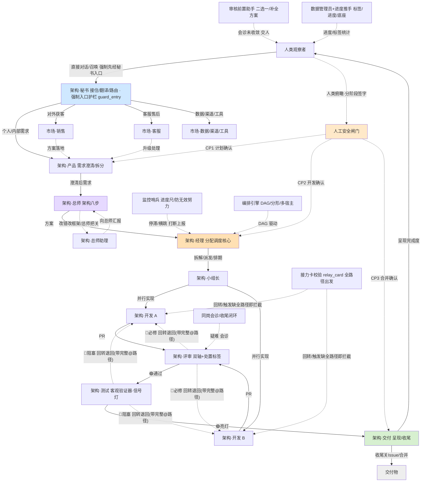

# 顶层架构拓扑

本文件描述 `dongjiagoushi`（架构师 Agent 框架）的顶层架构。这是「架构八步」中第 2 步「顶层架构拓扑」的沉淀与维护入口。

> ⚠️ **这不是"单架构师控制体系"**：本仓库早已升级为 **多角色协作流水线**——
> 有流程（DAG 非直线）、有互相调用（接力/触发/回转/打断）、有协作规则与托底机制。
> 「架构师」只是团队中**一个核心角色**（由官方 `@CodeBuddy` 化身、零积分执行）。
> 本图是全仓库拓扑**总入口**：入口路由 → 主线研发 DAG → 质量闸门 → 横向托底机制 → 人类俯瞰/CP 安全闸门。

## 一、整体拓扑（协作主图 · 多角色流水线 · 非单架构师控制）

> 图例：实线 = 主流程推进；虚线 = 回转打回 / 交叉调用 / 托底机制；
> ⏸CP1/⏸CP2/⏸CP3 人类安全闸门分阶段签字（见 README「协作主图」配文）；
> **客观验证器**：测试/评审用信号灯与确定性检查裁定是否合格，开发不自判"我完成了"；
> **强制入口护栏**：直接对话必先进「架构·秘书」接收→路由留痕，直接进研发属违规。
> 本图与 README「协作主图」同源同语义；README 侧重介绍，本文件作为全仓拓扑维护入口。

## 二、模块清单

| 模块 | 载体 | 职责 | 输入 | 输出 | 依赖 | 可独立演进 |
|------|------|------|------|------|------|-----------|
| **角色模块** | `.cnb/settings.yml` + `local-agent/roles/` | 定义架构师人设 + 秘书/产品/总师/经理/小组长/开发/评审/测试/交付等协作角色 | 需求 | 角色定义 | 无 | ✅ |
| **全路径触发/接力模块** | `local-agent/relay_card/` + `local-agent/roles/base.py` | 接力卡必须带完整 `@org/repo(角色)` + `[触发:角色]`，回转/转交**带路径出发**；缺全路径即 INVALID_RELAY 拦截 | 接力动作 | 合规接力卡 + 校验结果 | 角色模块 | ✅ |
| **偏好注入模块** | `.codebuddy/skills/architect/SKILL.md` | 架构师方法论，@CodeBuddy 自动加载 | 召唤语 | 架构八步执行 | 角色模块 | ✅ |
| **偏好注入模块** | `.codebuddy/skills/architect/SKILL.md` | 架构师方法论，@CodeBuddy 自动加载 | 召唤语 | 架构八步执行 | 角色模块 | ✅ |
| **流程编排模块** | `.cnb.yml` | 知识库入库 + npc:go 兜底 + codewiki | push/tag/评论事件 | CI 执行 | 无 | ✅ |
| **观测/决策模块** | docs + Issue/PR 留痕 | 二级信息、看板、风险矩阵、索引 | 各步产物 | 决策摘要 | 各模块 | ✅ |
| **安全护栏模块** | AGENTS.md + CP 暂停点 | CP1/CP2/CP3 人审批、敏感红线、风险显式暴露 | 流程状态 | 放行/拦截 | 流程编排 | ✅ |
| **知识库模块** | `knowledge:update` + codewiki | RAG，让架构师读信息条理全面 | docs/Issue | 可检索知识 | 流程编排 | ✅ |
| **经验记忆库+语义触发模块** | `src/memory/` | 统一向量格式 + LanceDB/云端双后端兼容 + 持续积累经验 + 语义向量触发引擎（真实向量检索，非关键词） | 协作交互/输入 | 可检索记忆 + 角色语义触发 | 流程编排 | ✅ |
| **看板模块** | `scripts/generate-dashboard.py` + `.cnb.yml` | 基于 Issue 声明头自动汇总模块版本演进看板 + 里程碑表 | Issue 声明头 | `docs/DASHBOARD.md` 二级信息 | 流程编排 | ✅ |
| **本地 Agent 模块** | `local-agent/` | 无 @ 环境下的 CLI 入口替代云端触发 + 团队流水线编排到交付 | 命令行/需求 | 交付报告 + 接力卡 | 无 | ✅ |
| **DAG 调度模块** | `local-agent/graph.py` | 拓扑排序 + 并行波次调度（非直线） | team.yaml 的 dag.nodes | 并行波次 | 无 | ✅ |
| **分形扩展模块** | `local-agent/fractal.py` | 开发按规模分形多小组 + 递归 | 任务清单 | 分形计划 | 无 | ✅ |
| **入口层模块** | `roles/secretary.py` + settings | 默认入口/意图翻译/路由 | 用户直接对话 | 路由到对应角色 | 无 | ✅ |
| **市场分层模块** | `roles/market.py` + settings | 销售/客服/数据/渠道/工具 通用基建 | 获客/服务诉求 | 获客产物 | 无 | ✅ |
| **跨平台适配模块** | `docs/PLATFORM_ADAPTERS.md` | cnb.cool / deepseek harness / MCP 蜂群适配方案 | 宿主触发 | 统一活动规则适配 | DAG/接力协议 | ✅ |
| **规模伸缩层模块** | `local-agent/scale/` | 可伸缩蜂群协作平台：规模声明 + 前置流程区分 + 角色插件 + 消息总线 + 状态分片 + 并发池 | `--spec/--profile/--scale` | 规模化交付报告 | 无 | ✅ |
| **数据管理层模块** | `local-agent/data/` | 数据库承载：内容存档/进度统计/消息管线/任务存储，支撑 2500 并发信息互通 | DB_BACKEND（SQLite 默认/PG） | 数据底座/统计报告 | scale 引擎 | ✅ |

## 三、数据流向

1. 人类在 Issue/PR 评论召唤（如 `@dongdongxiaozu/dongjiagoushi(架构·开发)`）或直接对话，**默认经「架构·秘书」**接住诉求并路由留痕（强制入口护栏）。
2. 秘书/经理/评审等派发方按职责域用接力卡唤醒下游：接力卡**带完整 `@org/repo(角色)` + `[触发:<角色>]`** 投递（全路径出发），对端回执 `[接单]` 才算真实唤醒（relay_card 校验 + awake 回执校验，未回执须重触发/升级）。
3. 角色沿 DAG 流水线产出（产品→总师→经理→小组长+开发并行→评审→测试→交付）；打回用 `[回转] 退回:<角色>` 且**必须带完整 @ 路径**（被打回=重新触发）；中断用 `[打断]` 留续跑点。
4. 每次协作交互（接力/回转/触发）写入经验记忆库（本地 LanceDB + 云端同格式），持续积累经验。
5. 每步真实执行并在 Issue/PR/提交/CI 留痕。
6. 到 CP 暂停点停下等人类确认；人类批准才放行下一阶段。
7. 最终输出二级信息（状态+风险+决策+索引）供人类决策。

## 四、关键取舍（为何这样设计）

- **一库多角色而非多库分角色**：skill 只在「本仓库」对话自动加载，跨库上下文断裂；单库共享架构/流水线/知识库，修改省劲、目标不偏差。
- **走 `.codebuddy/skills` 而非 npc:go systemPrompt**：自动加载、零积分、最贴合「官方 agent + 提示词注入」理念。
- **知识库走 CNB 原生**：天然集成，@CodeBuddy/架构师对话中直接 RAG 检索；Embedding 官方目前仅支持 `hunyuan`。
- **拒绝最小可行骨架**：直接搭完整可用的第一版，避免半成品污染。
- **语义向量触发走真实记忆库**：非 prompt/关键词层面的"语义映射表"，而是由 `src/memory/` 引擎做真实向量检索触发，本地 LanceDB 与云端 CNB 知识库同格式双兼容，可持续积累经验，满足"专业可靠"而非"轻量级"。

## 四·A、角色命名规范（区分度）

本体系所有可被 `@` 触发的角色名统一加「架构·」前缀形成命名空间，避免与其他团队的 agent 重名，且利于 `@` 后自动填充补全：

| 角色 name（settings.yml / roles 库） | 职责 | 补全提示词 |
|--------------------------|------|-----------|
| `架构·秘书` | 默认入口：接住诉求/翻译意图/路由（强制入口护栏） | `@` 输「架构」自动补全 |
| `架构·产品` | 需求澄清/拆分/验收标准 | 同上 |
| `架构·总师` | 架构八步设计核心 | 同上 |
| `架构·总师助理` | 较大任务下改错改框架专项（保总师上下文纯净） | 同上 |
| `架构·经理` | 分配调度核心（L1→L4 派发深度，锁 L4 开工交付） | 同上 |
| `架构·小组长` | 开发小组拆解/整合，组内收敛监督 | 同上 |
| `架构·开发` | 方案实现/自测（可并行分形） | 同上 |
| `架构·评审` | 质量守门员：双轴评审 + 统一处置标签 | 同上 |
| `架构·测试` | 质量验收：测试矩阵/信号灯（客观验证器） | 同上 |
| `架构·交付` | 全流程呈现 + 收尾交付（PR/关Issue/合并） | 同上 |
| `架构·监控哨兵` | 防无效努力：目标进度尺/停滞/横跳/重复错误 | 同上 |
| `架构·数据管理员` | 数据底座唯一负责人（存档/进度/消息/任务） | 同上 |
| `架构·进度推手` | 进度标签 + 优先级 P0-P9 + 自动化喂料 | 同上 |
| `架构·对齐` / `架构·找工具` | 版本对齐 / 工具依赖检索 | 同上 |
| 市场层 5 角色 | 销售/客服/数据/渠道/工具（通用基建） | 同上 |

`架构师` 一词保留为**体系品牌 / Skill 化身身份**（`.codebuddy/skills/architect`），在文档/方法论层面沿用；被 `@` 具体召唤的 NPC 角色名用带前缀的「架构·总师」等（完整角色清单以 `.cnb/settings.yml` 与 `local-agent/roles/` 为准）。

## 五、Issue 管理机制（版本化演进）

Issue 不是同层平铺的散点，而是**同一模块能力的版本化演进线**。每个 Issue 声明头锚定到所属模块与目标版本，使「开发好开发、合并好合并、可灵活接着开发」。详见 [docs/ISSUE_MANAGEMENT.md](ISSUE_MANAGEMENT.md) 与模板 [docs/templates/issue-template.md](templates/issue-template.md)。

- **模块（Module）**：版本管理的原子单位，独立维护语义化版本线 `vMAJOR.MINOR.PATCH`。
- **Issue 声明头**：`module / type / target / version / update / depends_on`，建立层级关系。
- **Issue 类型**：`init`（建模块 v0.1.0）/ `update`（MINOR 增强）/ `fix`（PATCH 修复）/ `standalone`（一次性）。
- **接力卡**：载体采用「Issue 评论内嵌结构化卡片」，Issue 声明定版本锚点、评论接力卡传协作上下文。

### 协作触发强制化（三层机制，非纸面说明）

协作角色不是"请自觉遵守"的说明文字，而是**可被机器/语义/规则三层强制触发的硬约束**（详见 `AGENTS.md` 与 `SKILL.md`）：

| 触发层 | 机制 | 优先级 |
|--------|------|--------|
| ① 显式声明（全路径出发） | 接力卡必须带**完整 `@org/repo(角色)` + `[触发:<角色全称>]`**；命中即自动化身该角色；**只写角色名/缺 @ 路径 = 无效接力**（唤醒不了对端，见 `relay_card`） | 最高 |
| ② 语义向量 | 输入/上下文语义命中职责域（需求→产品；写码→开发；评审→评审；测试→测试）自动切角色 | 中 |
| ③ rules 固定 | 仓库顶层 `AGENTS.md` 固定约束，任何被 @ 召唤的 agent 均受约束，兜底不失效 | 兜底 |

### 回转与打断协议（接力可被打回/中断续跑）

接力不是单向直线，必须能**打回重做**与**中断续跑**，否则下游不通过或任务中断即断链：

- **回转（打回）·带完整 @ 路径出发**：下游发现不达标（评审 🔴必修 / 测试 🔴阻塞）打回时，评论必须同时带：
  1. **完整召唤路径** `@dongdongxiaozu/dongjiagoushi(架构·开发)` —— 让平台真实推送唤醒被打回角色；
  2. **触发标记** `[触发:架构·开发]` —— 被打回 = 重新触发（AGENTS.md 显式声明最高优先）；
  3. **打回语义** `[回转] 退回:架构·开发 / 原因:<分级+问题> / 下一步要求:<可执行>`。
  三者缺一即属"想触发没唤醒"的**假触发**（#142 用户纠偏），须补齐后重新投递；被打回角色返工后交回下游复评，最多 3 次，超次标 `blocked` 上报。
- **打断（中断续跑）**：中断须发 `[打断]` 并留续跑点（`当前进度` 标已做到哪一步+卡点+下一步）；续跑凭 `当前进度` 从卡点无缝接续，不重做已完成部分。
- **状态机**：`[触发]→产出→[回转]→返工→复评→[触发]→...→🟢通过→回传总师`，任意环可 `[打断]` 续跑。由 `tests/test_relay_workflow.sh` 端到端可复现（T8）。
- **观测**：模块版本演进线即「能力成熟度看板」，供人类俯瞰。

## 六、演进方向（预留）

- ✅ 多角色人设已在 `.cnb/settings.yml` 补全为完整可执行（含触发强制化 + 回转/打断协议，见任务 B）。
- ✅ 协作触发三层机制（显式[触发]/语义/rules固定）与回转打断协议已落地到 `AGENTS.md`/`SKILL.md`/`settings.yml`，并由 `tests/test_relay_workflow.sh`（T8）端到端可复现（见本批任务）。
- 按需扩展知识库检索范围（见任务 C）。
- ✅ 经验记忆库 + 语义向量触发已落地：`src/memory/`（统一向量格式 + LanceDB/云端双后端兼容 + 持续积累经验 + 语义向量触发引擎），由 `tests/test_memory_store.sh`（T9）端到端可复现（见本批任务）。
- ✅ 模块版本演进看板自动化汇总已落地：`scripts/generate-dashboard.py` → `docs/DASHBOARD.md`，由 `.cnb.yml` 在 Issue 增改删时自动刷新（见任务 D）。
