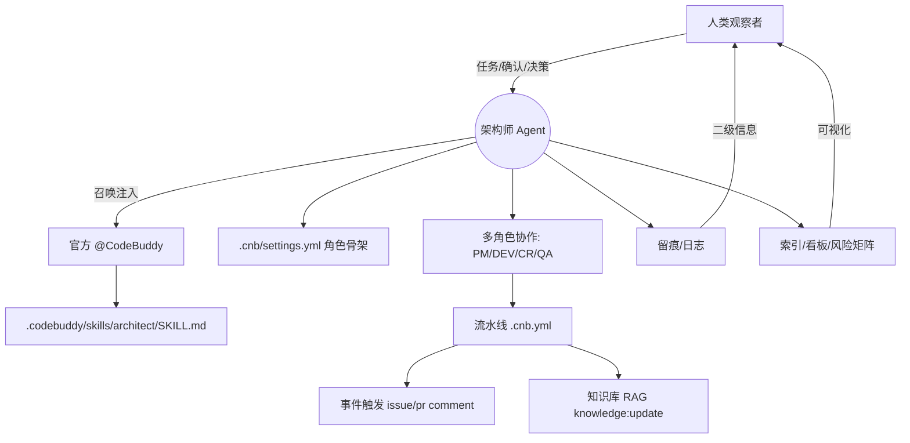

# 顶层架构拓扑

本文件描述 `dongjiagoushi`（架构师 Agent 框架）的顶层架构。这是「架构八步」中第 2 步「顶层架构拓扑」的沉淀与维护入口。

## 一、整体拓扑

## 二、模块清单

| 模块 | 载体 | 职责 | 输入 | 输出 | 依赖 | 可独立演进 |
|------|------|------|------|------|------|-----------|
| **角色模块** | `.cnb/settings.yml` | 定义架构师人设 + PM/DEV/CR/QA 扩展位 | 需求 | 角色定义 | 无 | ✅ |
| **偏好注入模块** | `.codebuddy/skills/architect/SKILL.md` | 架构师方法论，@CodeBuddy 自动加载 | 召唤语 | 架构八步执行 | 角色模块 | ✅ |
| **流程编排模块** | `.cnb.yml` | 知识库入库 + npc:go 兜底 + codewiki | push/tag/评论事件 | CI 执行 | 无 | ✅ |
| **观测/决策模块** | docs + Issue/PR 留痕 | 二级信息、看板、风险矩阵、索引 | 各步产物 | 决策摘要 | 各模块 | ✅ |
| **安全护栏模块** | AGENTS.md + CP 暂停点 | CP1/CP2/CP3 人审批、敏感红线、风险显式暴露 | 流程状态 | 放行/拦截 | 流程编排 | ✅ |
| **知识库模块** | `knowledge:update` + codewiki | RAG，让架构师读信息条理全面 | docs/Issue | 可检索知识 | 流程编排 | ✅ |

## 三、数据流向

1. 人类在 Issue/PR 评论召唤 `@CodeBuddy`（提及 architect skill）。
2. `@CodeBuddy` 自动加载 skill，化身架构师，读取知识库/上下文。
3. 架构师按八步产出，需协作时用接力卡召唤 PM/DEV/CR/QA。
4. 每步真实执行并在 Issue/PR/提交/CI 留痕。
5. 到 CP 暂停点停下等人类确认；人类批准才放行下一阶段。
6. 最终输出二级信息（状态+风险+决策+索引）供人类决策。

## 四、关键取舍（为何这样设计）

- **一库多角色而非多库分角色**：skill 只在「本仓库」对话自动加载，跨库上下文断裂；单库共享架构/流水线/知识库，修改省劲、目标不偏差。
- **走 `.codebuddy/skills` 而非 npc:go systemPrompt**：自动加载、零积分、最贴合「官方 agent + 提示词注入」理念。
- **知识库走 CNB 原生**：天然集成，@CodeBuddy/架构师对话中直接 RAG 检索；Embedding 官方目前仅支持 `hunyuan`。
- **拒绝最小可行骨架**：直接搭完整可用的第一版，避免半成品污染。

## 四·A、角色命名规范（区分度）

本体系所有可被 `@` 触发的角色名统一加「架构·」前缀形成命名空间，避免与其他团队的 agent 重名，且利于 `@` 后自动填充补全：

| 角色 name（settings.yml） | 职责 | 补全提示词 |
|--------------------------|------|-----------|
| `架构·总师` | 主角色，架构八步 | `@` 输「架构」自动补全 |
| `架构·产品` | 需求澄清/拆分 | 同上 |
| `架构·开发` | 方案实现/自测 | 同上 |
| `架构·评审` | 五维评审/复评 | 同上 |
| `架构·测试` | 测试矩阵/信号灯 | 同上 |

`架构师` 一词保留为**体系品牌 / Skill 化身身份**（`.codebuddy/skills/architect`），在文档/方法论层面沿用；被 `@` 具体召唤的 NPC 角色名用带前缀的「架构·总师」等。

## 五、Issue 管理机制（版本化演进）

Issue 不是同层平铺的散点，而是**同一模块能力的版本化演进线**。每个 Issue 声明头锚定到所属模块与目标版本，使「开发好开发、合并好合并、可灵活接着开发」。详见 [docs/ISSUE_MANAGEMENT.md](ISSUE_MANAGEMENT.md) 与模板 [docs/templates/issue-template.md](templates/issue-template.md)。

- **模块（Module）**：版本管理的原子单位，独立维护语义化版本线 `vMAJOR.MINOR.PATCH`。
- **Issue 声明头**：`module / type / target / version / update / depends_on`，建立层级关系。
- **Issue 类型**：`init`（建模块 v0.1.0）/ `update`（MINOR 增强）/ `fix`（PATCH 修复）/ `standalone`（一次性）。
- **接力卡**：载体采用「Issue 评论内嵌结构化卡片」，Issue 声明定版本锚点、评论接力卡传协作上下文。
- **观测**：模块版本演进线即「能力成熟度看板」，供人类俯瞰。

## 六、演进方向（预留）

- 多角色人设逐步在 `.cnb/settings.yml` 补全（当前为扩展位）。
- 按需扩展知识库检索范围、可视化看板自动化。
- 模块版本演进看板自动化汇总（接 Issue 声明头自动生成）。
