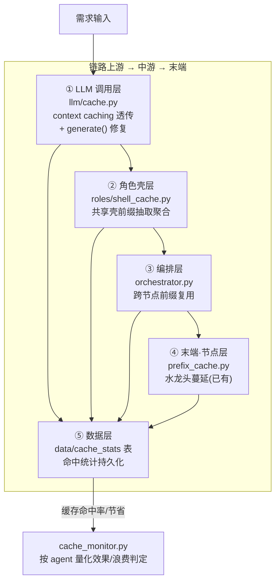

# 全链路缓存架构（Cache Architecture）

> Issue #41 全链路缓存优化。用户核心诉求：
> **"这一路从上到下都要，不是只有末端的散沙才开始"** —— 从 LLM 调用层到角色壳、
> 编排层、末端拓扑节点、数据层，全链路共享前缀复用，量化 token 效果、判定是否浪费。

## 背景：为什么从末端延伸到全链路

原有 `topology/prefix_cache.py` 只优化了**最末端拓扑节点**的散沙（水龙头蔓延）。
但整条 agent 流水线在 LLM 调用、角色壳、编排层也反复构造完整共享上下文，存在大量可复用的前缀。

参考 deepseek **context caching / prompt prefix caching** 机制
（`extra_headers: {"ep_ctxcache":"1"}`，命中相同前缀按增量计费），
把「前缀缓存」从末端一路延伸，形成 **5 层全链路缓存**。

## 五层缓存架构



| 层 | 模块 | 职责 |
|----|------|------|
| ① LLM | `local-agent/llm/cache.py` | context caching 参数透传（`ep_ctxcache`）+ `generate()` 别名修复 + 缓存命中监控记录 |
| ② 角色壳 | `local-agent/roles/shell_cache.py` | 抽取各角色共享壳前缀，跨角色聚类复用 |
| ③ 编排层 | `local-agent/orchestrator.py` | 跨节点复用共享 req 前缀，记录编排层命中事件 |
| ④ 末端节点 | `local-agent/topology/prefix_cache.py` | 保留水龙头蔓延 + `extend_shared_prefix` 接入上游共享前缀 |
| ⑤ 数据层 | `local-agent/data/schema.py` | 新增 `cache_stats` 表，持久化各 agent × 层命中/节省 |

## 核心模块说明

### ① LLM 层 `llm/cache.py`

- `build_cache_headers()`：构造 `extra_headers: {"ep_ctxcache":"1"}` 透传头（可环境变量关）。
- `record_cache_event(agent, layer, cache_hit, prefix_chars, saved_tokens)`：
  按 agent × 层记录缓存事件，供命中监控。
- `split_prefix_suffix()`：把「稳定共享前缀」与「变化增量后缀」拆分，最大化前缀命中。
- `generate()` 别名：修复 `benchmark.py` 调用 `llm.generate()` 而后端只有 `call()` 的**断裂 bug**
  （已核验 `grep -rn "def generate"` 为空，真实 LLM 路径会崩）。

### ② 角色壳层 `roles/shell_cache.py`

各角色 `SYSTEM_PROMPT` 天然共享「协作纪律/触达协议」尾部模板。模块抽取：
- `shared_shell_prefix(roles)`：求一组角色 SYSTEM_PROMPT 的公共前缀。
- `cluster_roles(roles)`：按共同壳前缀聚合角色集群，集群内首角色付全量前缀、后续角色命中缓存。
- `role_specific_tail(role)`：角色差异后缀（放前缀之后，只按增量计费）。
- `cache_cost_for_cluster()`：算集群缓存 token 成本。

### ③ 编排层 `orchestrator.py`

`_run_one()` 记录编排层缓存命中事件（agent × 层=orchestrator），
跨节点复用共享 req 前缀。`role.run()` 内部已做角色壳层缓存。

### ④ 末端节点 `prefix_cache.py`

新增 `extend_shared_prefix(prefix, upstream_prefix)`：把上游壳层共享前缀叠加进末端集群前缀，
`analyze_with_upstream()` 给出带上游的全链路缓存分析。

### ⑤ 数据层 `data/schema.py`

新增 `cache_stats` 表：
```
cache_stats(id, agent, layer, cache_hits, cache_misses, cache_hit_rate,
            prefix_chars, saved_tokens, req_key, gid, created_at)
```
由「架构·数据管理员」统一统计，供人类俯瞰。

## 修复的既有 bug

- **`max_concurrency` 未初始化**（`benchmark.py` `_run_batch` 引用 `nonlocal max_concurrency` 但外层未赋初值，
  运行时抛 `SyntaxError: no binding for nonlocal`）→ 补 `max_concurrency = 0`。
  这是用户所指「框架方向对但 bug 多」的一个实例，已随本次修复。
- **`llm.generate()` 断裂**（benchmark 调用点）→ 基类补 `generate()` 别名。

## 测试

`local-agent/tests/test_cache_layer.sh`（信号灯，7 项）：
- M1 generate 修复 + ctxcache 透传
- M2 shell_cache 前缀抽取 + 集群聚合
- M3 编排层缓存事件记录
- M4 prefix_cache 接入上游共享前缀
- M5 cache_stats 表读写
- M6 缓存命中监控（高命中=无浪费、低命中+重复构造=有浪费）
- M6b 缓存监控持久化

## 相关文档

- `docs/CACHE_MONITOR.md` — 缓存命中监控机制（按 agent 量化效果/浪费判定）
- `docs/BENCHMARK_AB.md` — AB 隔离对比框架
- `docs/TOPOLOGY_COMPARISON.md` — 拓扑对比基准
