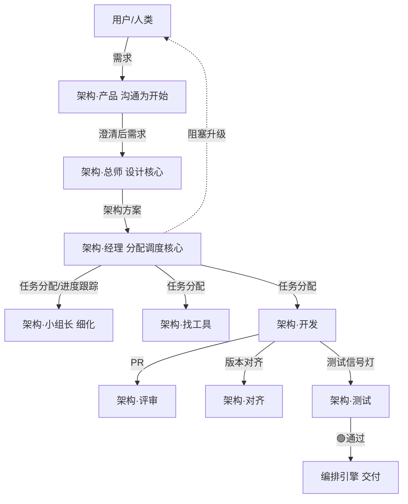

# 外层壳 · 三核心协作体系架构设计（FRAMEWORK_SHELL）

> 本文件是 Issue #16「以本仓库为载体，用架构师 skill 自我开发外层的壳，实现项目升级」的架构八步产物留痕。
> 执行角色：架构·总师（官方 @CodeBuddy 化身）
> 场景对象：**让当前 `dongjiagoushi` 项目作为功能测试载体，自我升级为「产品沟通为开始 → 架构师为设计核心 → 经理为分配调度核心」的完整协作体系外层壳**。
> 核心结论：本仓库 `local-agent/` 团队流水线**天然就是"外层的壳"**（需求→交付闭环已具备）；本次自升级增量是补强「架构·经理」作为**分配调度核心**，并让该链路成为可执行、可测试、可留痕的真实体系。

---

## ⏸CP0 · 需求澄清摘要

- **目标**：用架构师 skill 设计一个三核心协作体系，并让当前仓库自我开发出承载该体系的外层壳，实现项目升级（也是架构师 skill 的功能测试）。
- **三核心链路**：
  - **产品经理沟通为开始**（`架构·产品`：沟通对接/澄清需求/翻译意图/拆需求）
  - **架构师为设计核心**（`架构·总师`：架构八步，定"做什么/为何做"）
  - **经理为分配调度核心**（`架构·经理`：定"谁来做/何时做完/怎么分配"，跟踪进度、升级阻塞）
- **边界**：本次在**当前仓库**落地（用户倾向 + 架构评估均支持），不另建仓库；隔离需求通过 local-agent（本地）与 settings.yml（云端）双载体满足。
- **验收标准**：
  1. 现有在线功能测试全部通过（信号灯 🟢）；
  2. 新增「架构·经理」分配调度核心角色，注册到 settings.yml / local-agent / team.yaml；
  3. 流水线链路变为「产品→架构→经理→小组长→…→测试→交付」，经理承担分配调度；
  4. 测试脚本断言「经理调度核心」链路真实落地；
  5. 文档同步，产出留痕。
- **关键不确定项**：仓库隔离决策（已在下方评估，结论为当前库）。

---

## 1/8 调研报告

### 用户诉求拆解
- **"在线功能测试"**：跑通现有全部测试套件，验证体系当前状态（信号灯）——已执行，180/180 全绿 ✅。
- **"本地适配/自我开发外层壳"**：让当前仓库作为载体，长出承载"三核心体系"的外层壳。
- **仓库隔离抉择**：当前库 vs 另建库发布整个体系。

### 现状盘点（调研结论）
| 能力 | 现状 | 本次增量 |
|------|------|---------|
| 产品沟通为开始 | ✅ `架构·产品` 已存在 | — |
| 架构师为设计核心 | ✅ `架构·总师` + architect skill 已存在 | — |
| **经理为分配调度核心** | ⚠️ 无显式角色；分工散落在`架构·产品`/`架构·小组长` | **新增 `架构·经理`** |
| 外层壳（需求→交付闭环） | ✅ `local-agent/` 流水线已具备雏形 | 补强经理调度步骤 |
| 在线功能测试 | ✅ 6 套测试 180/180 | 补充经理调度断言 |

### 仓库隔离评估（关键决策）
| 方案 | 优点 | 缺点 | 结论 |
|------|------|------|------|
| **当前库做**（用户倾向） | ① local-agent 已是"外层壳"雏形；② 天然是架构师功能测试；③ 避免另起炉灶重复搭团队骨架；④ 单库共享架构/流水线/知识库，修改省劲、目标不偏差 | 仓库概念更重 | ✅ **采用**（与用户倾向一致，也符合本库"一库多角色"既定原则） |
| 另建库隔离 | 仓库职责单一 | ① 重复搭团队骨架成本高；② skill 跨库不自动加载，上下文断裂；③ 与 AGENTS.md"一库多角色"理念冲突 | ❌ 不采用 |

### 参考与取舍
- 三核心链路借鉴了真实组织中 PM/Architect/Manager 的分工：**产品管"要什么"、架构管"怎么做才对"、经理管"谁来做、何时完"**。
- 取舍：不做复杂的多库微服务，而用"一库多角色 + local-agent 本地壳 + settings.yml 云端人设"双载体，保证既有云端 `@CodeBuddy` 触发、又有本地 CLI 触发。

---

## 2/8 顶层架构拓扑



### 模块清单（本次增量聚焦）
| 模块 | 载体 | 职责 | 输入 | 输出 | 依赖 | 可独立演进 |
|------|------|------|------|------|------|-----------|
| **分配调度模块** | `架构·经理` | 任务拆解/角色分配/调度编排/进度跟踪 | 架构方案 | 可执行任务分配 | 产品+总师 | ✅ |
| **本地壳** | `local-agent/` | 无 @ 环境 CLI 触发 + 团队流水线编排到交付 | 命令行/需求 | 交付报告+接力卡 | 角色库 | ✅ |
| **云端壳** | `.cnb/settings.yml` | `@CodeBuddy` 触发时的角色人设 | 召唤语 | 角色执行 | 无 | ✅ |

---

## 3/8 可行性验证

| 关键假设 | 验证方式 | 结论 |
|---------|---------|------|
| local-agent 流水线可编排多角色到交付 | `test_local_agent.sh` 跑通 full 流水线 | ✅ 可行 |
| 新增"架构·经理"角色可注册并触发 | manager.py + __init__.py + team.yaml 注册，单角色触发 | ✅ 可行 |
| 流水线把"经理调度"插入 architect 之后 | team.yaml pipeline 加 plan 步骤 → 经理 | ✅ 可行 |
| 在线测试对新增经理链路可断言 | test_relay_workflow.sh 场景G + test_local_agent.sh | ✅ 可行 |
| 当前库承载（不隔离） | local-agent 即外层壳，天然支持 | ✅ 可行（采用） |

全部关键假设**可行**，无暂缓/高风险项。

---

## 4/8 工程实施方案

### 改动文件清单
| 文件 | 改动 |
|------|------|
| `local-agent/roles/manager.py` | **新增**：架构·经理角色模块（分配调度核心） |
| `local-agent/roles/__init__.py` | 注册 `架构·经理` |
| `local-agent/team.yaml` | roles 增加经理；pipeline 在 architect 后插入经理调度步骤 |
| `.cnb/settings.yml` | 新增 `架构·经理` 角色人设（含[触发]显式标记 + 语义触发词） |
| `local-agent/tests/test_local_agent.sh` | 经理单角色触发断言 + 角色数 8→9 + 经理注册断言 |
| `tests/test_relay_workflow.sh` | 新增场景G：经理调度核心真实落地断言 |
| `docs/FRAMEWORK_SHELL.md` | **新增**：本架构设计留痕 |
| `README.md` / `docs/LOCAL_AGENT.md` | 同步三核心链路与经理角色 |

### 接口契约（架构·经理）
```
输入:  架构·总师的架构方案接力卡
输出:  任务拆解清单 / 角色分配(负责人/输入/输出/依赖/优先级) / 调度编排 / 进度跟踪
触发:  [触发:架构·经理] 显式 或 语义命中"分配/调度/派活/派任务/经理"
```

---

## 5/8 分工与协作规则

| 环节 | 角色 | 职责 |
|------|------|------|
| 开始 | 架构·产品 | 沟通对接、澄清需求 |
| 核心 | 架构·总师 | 架构八步，定方案 |
| **分配调度** | **架构·经理** | **拆任务、派活、排期、跟进度、升级阻塞** |
| 细化 | 架构·小组长 | 子任务细化协调 |
| 实现 | 架构·开发 | 写码自测提 PR |
| 评审/对齐/测试 | 架构·评审/对齐/测试 | 质量守护、版本对齐、信号灯 |

接力规则不变：接力卡带 `[触发]` 显式标记；回转/打断协议沿用。

---

## 6/8 进度对齐

| 里程碑 | 验收 | 状态 |
|--------|------|------|
| M1 在线功能测试 | 6 套测试全绿 | ✅ 已完成（180/180） |
| M2 经理角色落地 | 角色注册 + 触发 | ✅ 本次实现 |
| M3 流水线编排 | full 跑通含经理调度 | ✅ 本次实现 |
| M4 测试断言 | 场景G + local-agent 断言 | ✅ 本次实现 |
| M5 文档同步 | README/LOCAL_AGENT 同步 | ✅ 本次实现 |
| M6 合并确认 | CP3 用户确认 | ⏳ 待用户放行 |

暂停点：⏸CP2 开发确认（方案已出，待用户确认后合并实现）、⏸CP3 合并确认（PR 提交后待用户放行）。

---

## 7/8 索引建立

| 产物 | 留痕位置 |
|------|---------|
| 架构设计 | `docs/FRAMEWORK_SHELL.md`（本文件） |
| 经理角色实现 | `local-agent/roles/manager.py` |
| 云端人设 | `.cnb/settings.yml` |
| 团队配置 | `local-agent/team.yaml` |
| 测试断言 | `tests/test_relay_workflow.sh`(场景G) + `local-agent/tests/test_local_agent.sh` |
| 交付 PR | 本次提交 PR 链接 |

---

## 8/8 汇报与复盘

### 决策摘要
- **已定**：三核心链路（产品沟通→架构师设计→经理调度）在当前库落地；新增 `架构·经理` 为分配调度核心；不另建仓库。
- **待定**：⏸CP2 开发确认、⏸CP3 合并确认（需用户本人放行）。

### 风险清单
| 风险 | 等级 | 规避方案 |
|------|------|---------|
| 角色数/流水线变更破坏现有测试 | LOW | 同步更新 test_local_agent.sh / test_relay_workflow.sh 断言 |
| 经理与小组长职责重叠 | MEDIUM | 明确：经理=分配调度核心（排期/派活/跟进度），小组长=子任务细化协调，二者分层 |
| 文档漂移 | LOW | README/LOCAL_AGENT/ARCHITECTURE 同步 + doc-consistency 测试 |

### 复盘四要素
- **根因**：用户希望当前项目通过架构师自我升级为三核心体系外层壳，作为功能测试。
- **教训**：新增角色需同步"代码 + 配置 + 人设 + 测试 + 文档"五处，缺一处即漂移。
- **预防机制**：test_doc_consistency.sh + 场景G 断言兜底。
- **已落地**：经理角色 + 流水线 + 测试断言 + 文档。
