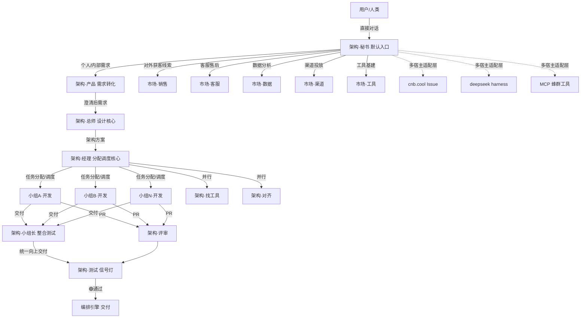

# 体系扩展 · 五维增强架构设计（FRAMEWORK_V2）

> 本文件是 Issue #18「继续扩展这个体系，提高完善程度」的架构八步产物留痕。
> 执行角色：架构·总师（官方 @CodeBuddy 化身）
> 场景对象：**在现有「架构师 + 多角色团队」体系上，补齐 5 个关键扩展**——让流水线从直线升级为 DAG、开发可分形多小组、市场获客分层为通用基建、默认入口改为产品经理/秘书、并适配多种宿主平台（cnb.cool / deepseek harness / MCP 蜂群）。
> 核心结论：体系从「单线串行的工程团队」升级为「**DAG 并行 + 分形可伸缩 + 市场分层 + 入口路由 + 多宿主适配**」的完整协作体系。

---

## ⏸CP0 · 需求澄清摘要

- **目标**：在现有体系上做五维增强，使其更完善、更贴近真实组织运作与个人/企业双场景。
- **五维增强**：
  1. **DAG（有向无环图）流水线**：替代直线串行，支持依赖满足即并行、提前分工；
  2. **开发分形扩展（多小组）**：开发按项目规模灵活拆多小组，小组长整合测试后统一向上交付；
  3. **市场获客分层**：工具/数据/渠道/客服/销售 通用基建；
  4. **产品经理/秘书默认入口**：个人需求优先，直接对话默认到产品经理/秘书；到其他身份用 `@CodeBuddy` 主动触发；
  5. **多宿主平台适配**：适配 cnb.cool / deepseek harness / MCP 蜂群调度，统一活动规则。
- **验收标准**：
  1. `local-agent` 流水线支持 DAG 调度（拓扑排序 + 并行波次），经理可在架构明确后提前分工；
  2. 开发节点支持分形多小组并行 + 小组长整合；
  3. 新增入口角色「架构·秘书」+ 市场层 5 角色（销售/客服/数据/渠道/工具），注册到 settings.yml / roles / team.yaml；
  4. 默认入口协议（秘书路由）写入 AGENTS.md；
  5. 跨平台适配方案文档化（cnb.cool / deepseek harness / MCP）。
- **关键不确定项**：跨平台适配的落地深度（本次先文档化适配方案 + 统一活动规则，真实插件接入作为后续迭代）。

---

## 1/8 调研报告

### 用户诉求拆解（逐条映射到增强点）

| 用户原话要点 | 映射的增强点 | 落地载体 |
|-------------|-------------|---------|
| "有些是单线的，需要顺序做…架构师明确架构后…经理也可以开始分工…完全等待架构完成比较久" | **DAG 并行 + 提前分工** | `local-agent/graph.py` + `team.yaml` 的 `dag` 定义 |
| "似乎有向无环图或者其他形式比一个直线合理" | **DAG 替代直线** | `graph.py` 拓扑排序 + 波次并行 |
| "开发…包含小组内…灵活几个小组…交付到小组长那里，他再测试整和后统一向上交付" | **开发分形扩展（多小组）** | `local-agent/fractal.py` |
| "现在还没完成这部分自动分形扩展，灵活加agent小组提升开发效率" | **分形自动扩展** | `fractal.build_fractal_plan` 按规模切分 |
| "市场获客…有部分能力是通用的基建，这里还得有工具层、数据层、渠道层、客服、销售等" | **市场获客分层（通用基建）** | `roles/market.py` + settings.yml |
| "大部分时候都是服务于个人需求后的开发…一开始对话的角色不是销售而是产品经理…默认到产品经理或者秘书的角色" | **产品经理/秘书默认入口** | `roles/secretary.py` + AGENTS.md 入口协议 |
| "到其他身份的对话用 @CodeBuddy 主动触发" | **入口路由 + 显式触发切换** | 秘书路由 + `[触发]` 协议 |
| "参考蜂群调度agent或者mcp的项目…适配cnb.cool和deepseek harness…有对应的活动规则的适配" | **跨平台适配（cnb.cool / deepseek / MCP 蜂群）** | 见 §5 平台适配方案 |

### 现状盘点（调研结论）

| 能力 | 现状 | 本次增量 |
|------|------|---------|
| 团队流水线 | ⚠️ 直线串行（product→architect→plan→lead→develop→…） | **升级为 DAG 并行** |
| 提前分工 | ❌ 无（plan 严格等 develop 前链） | **plan 只依赖 architect，可提前分工** |
| 开发分形 | ❌ 无（单点串行） | **新增 fractal 分形引擎** |
| 入口层 | ❌ 无（用户直接面对产品） | **新增 架构·秘书 默认入口** |
| 市场获客 | ❌ 无 | **新增市场层 5 角色（通用基建）** |
| 平台适配 | ❌ 无（仅 cnb.cool 云端 + 本地 CLI） | **新增跨平台适配方案** |

### 参考与取舍
- **DAG 调度**借鉴真实项目依赖图（如 Airflow/Temporal 的 DAG 工作流）：节点 + 依赖边，拓扑排序 + 并行波次。取舍：不做超重调度器，提供轻量 DAG 引擎满足本团队编排即可。
- **分形扩展**借鉴「蜂群调度 / 自主 agent 集群」思想（swarm 中个体可扩展、可递归分群）。取舍：本次实现可递归分形骨架，小组内递归深度控制避免无限。
- **市场分层**借鉴真实市场组织（销售/客服/数据/渠道/工具），沉淀通用基建而非单次流程。
- **入口路由**借鉴「前台接待/秘书」模式：先接住、再路由，不强迫用户一开始就选身份。
- **跨平台适配**参考 MCP（Model Context Protocol）与蜂群调度 agent 项目的"统一协议 + 多宿主适配"思想：把「接力卡 + DAG + 分形」抽象为**统一活动规则**，各宿主（cnb.cool Issue / deepseek harness / MCP 工具）做适配层。

---

## 2/8 顶层架构拓扑



### 模块清单（本次新增/增强聚焦）
| 模块 | 载体 | 职责 | 依赖 | 可独立演进 |
|------|------|------|------|-----------|
| **DAG 调度模块** | `local-agent/graph.py` | 拓扑排序 + 并行波次调度 | 无 | ✅ |
| **分形扩展模块** | `local-agent/fractal.py` | 开发按规模分形多小组 + 递归 | 无 | ✅ |
| **入口层模块** | `roles/secretary.py` + settings | 默认入口/路由 | 无 | ✅ |
| **市场分层模块** | `roles/market.py` + settings | 销售/客服/数据/渠道/工具 通用基建 | 无 | ✅ |
| **多宿主适配模块** | `docs/PLATFORM_ADAPTERS.md`（方案） | cnb.cool / deepseek harness / MCP 适配 | DAG/接力协议 | ✅ |

---

## 3/8 可行性验证

| 关键假设 | 验证方式 | 结论 |
|---------|---------|------|
| DAG 可拓扑排序 + 波次并行 | `python3 -c` 加载 graph.py 验证 waves | ✅ 可行（已跑通，含并行波次） |
| plan 只依赖 architect 可提前分工 | DAG 校验断言 plan.depends_on 含 architect 不含 develop | ✅ 可行 |
| 开发可分形多小组 | `fractal.build_fractal_plan(10任务)` → 3 组 | ✅ 可行 |
| 秘书/市场角色可注册触发 | `run.py --role 架构·秘书 / 市场·销售` | ✅ 可行 |
| 流水线含秘书入口 + DAG 编排跑通 | `run.py --pipeline full` 全链路 | ✅ 可行 |
| 跨平台适配（cnb.cool/deepseek/MCP） | 方案化（§5）+ 统一活动规则 | 🟡 本次文档化，真实插件接入后续 |

全部关键假设可行或文档化，无暂缓高风险项（跨平台接入作为后续迭代）。

---

## 4/8 工程实施方案

### 改动文件清单
| 文件 | 改动 |
|------|------|
| `local-agent/graph.py` | **新增**：DAG 引擎（拓扑 + 波次） |
| `local-agent/fractal.py` | **新增**：分形扩展引擎 |
| `local-agent/roles/secretary.py` | **新增**：架构·秘书（默认入口） |
| `local-agent/roles/market.py` | **新增**：市场层 5 角色 |
| `local-agent/roles/__init__.py` | 注册秘书 + 市场层（9→15 角色） |
| `local-agent/team.yaml` | roles 增补 + 新增 `pipeline.dag`（DAG 定义，保留线性 steps 兼容） |
| `local-agent/orchestrator.py` | 集成 DAG 调度 + 分形执行 + 秘书入口 |
| `local-agent/tests/test_local_agent.sh` | 15 角色断言 + 秘书/市场/DAG/分形断言 |
| `.cnb/settings.yml` | 新增 架构·秘书 + 市场·销售/客服/数据/渠道/工具 人设 |
| `AGENTS.md` | 新增默认入口协议 + 流水线扩展（DAG/分形/市场分层） |
| `docs/FRAMEWORK_V2.md` | **新增**：本架构设计留痕 |
| `docs/PLATFORM_ADAPTERS.md` | **新增**：跨平台适配方案（cnb.cool/deepseek/MCP 蜂群） |
| `docs/ARCHITECTURE.md` | 更新拓扑与模块清单 |
| `docs/ROADMAP.md` | 新增 M19-M22 里程碑 |
| `README.md` | 同步扩展能力与目录 |

### 接口契约（DAG 引擎）
```
输入:  team.yaml 的 pipeline.dag.nodes（node: id/role/action/depends_on[/fractal]）
调度:  拓扑排序 → 按依赖把满足条件的节点分到同一「波次」并行
输出:  waves（list[list[id]]）—— 每波内节点可并行
校验:  validate() 拦截依赖缺失 / 环
```

### 接口契约（分形引擎）
```
输入:  task_ids + 规模参数(max_per_team/min_tasks)
输出:  plan{ team_count, teams[{team_id,tasks}], scaled, recurse }
执行:  每小组「开发 → 小组长整合测试 → 统一向上交付」
```

---

## 5/8 分工与协作规则 + 跨平台适配方案

### 新增协作规则
| 环节 | 角色 | 职责 |
|------|------|------|
| 默认入口 | **架构·秘书** | 接住诉求、翻译意图、路由到对应角色 |
| 需求转化 | 架构·产品 | 个人/内部需求转化 |
| 市场获客 | 市场·销售/客服/数据/渠道/工具 | 对外获客分层 |
| 调度 | 架构·经理 | 任务拆解、分形分组、排期 |
| 开发 | 架构·开发（多小组并行） | 分形小组实现 |
| 整合 | 架构·小组长 | 多小组整合测试统一交付 |

接力/回转/打断协议沿用不变。

### 跨平台适配方案（cnb.cool / deepseek harness / MCP 蜂群）

把本体系的**协作核心抽象为「统一活动规则」**，各宿主通过适配层接入：

| 宿主 | 触发形式 | 适配方式 | 活动规则映射 |
|------|---------|---------|-------------|
| **cnb.cool（当前）** | Issue/PR 评论 `@CodeBuddy` | 原生集成（当前路径） | 接力卡 = Issue 评论内嵌结构化卡片；`[触发]`/`[回转]`/`[打断]` 标记 |
| **deepseek harness** | 本地 harness 驱动 | 把 `local-agent` 作为 harness 的 agent 团队，`run.py` 作为入口脚本 | 同一 `local-agent/team.yaml` DAG + 角色库，harness 逐节点调度 |
| **MCP（Model Context Protocol）蜂群** | MCP 工具调用 | 把团队流水线暴露为 MCP 工具（如 `dag_run`/`role_invoke`/`swarm_scale`），蜂群 agent 通过标准 MCP 协议调用 | 接力卡 → MCP 会话上下文；DAG/分形 → MCP 资源/工具；`[触发]` → 工具参数 |

**统一活动规则（各宿主共同遵守）**：
1. **同一套角色**：秘书/产品/总师/经理/小组长/开发/评审/对齐/找工具/测试/市场层 —— 定义在 `settings.yml` + `roles/*.py`，各宿主共享；
2. **同一套接力卡**：`task_book + 输入上下文 + 当前进度 + 下一步 + 接手角色 + 输出契约` 五要素，任一宿主可读；
3. **同一套 DAG 调度**：节点 + 依赖 + 并行波次，`graph.py` 通用；
4. **同一套触发协议**：显式 `[触发]` / 语义 / rules 固定，跨宿主一致；
5. **同一套回转/打断**：`[回转]` 打回、`[打断]` 续跑。

> 详细适配设计见 [docs/PLATFORM_ADAPTERS.md](PLATFORM_ADAPTERS.md)。

---

## 6/8 进度对齐

| 里程碑 | 验收 | 状态 |
|--------|------|------|
| M1 DAG 引擎落地 | graph.py 拓扑+波次 | ✅ 本次实现 |
| M2 分形引擎落地 | fractal 10任务→3组 | ✅ 本次实现 |
| M3 入口+市场角色 | 秘书 + 市场5角色注册 | ✅ 本次实现 |
| M4 DAG 流水线编排 | run.py --pipeline full 含秘书入口 | ✅ 本次实现 |
| M5 测试断言 | local-agent 19 项全绿 + 主测试套件绿 | ✅ 本次实现 |
| M6 平台适配方案 | docs/PLATFORM_ADAPTERS.md | ✅ 本次实现（文档化） |
| M7 文档同步 | FRAMEWORK_V2/ARCHITECTURE/ROADMAP/README/AGENTS | ✅ 本次实现 |
| M8 合并确认 | ⏸CP3 用户确认 | ⏳ 待用户放行 |

暂停点：⏸CP3 合并确认（PR 提交后待用户本人放行）。

---

## 7/8 索引建立

| 产物 | 留痕位置 |
|------|---------|
| 本架构设计 | `docs/FRAMEWORK_V2.md`（本文件） |
| DAG 引擎 | `local-agent/graph.py` |
| 分形引擎 | `local-agent/fractal.py` |
| 秘书角色 | `local-agent/roles/secretary.py` |
| 市场层角色 | `local-agent/roles/market.py` |
| 团队/DAG 配置 | `local-agent/team.yaml` |
| 云端人设 | `.cnb/settings.yml` |
| 入口协议 | `AGENTS.md` |
| 平台适配方案 | `docs/PLATFORM_ADAPTERS.md` |
| 测试断言 | `local-agent/tests/test_local_agent.sh` |
| 交付 PR | 本次提交 PR 链接 |

---

## 8/8 汇报与复盘

### 决策摘要
- **已定**：五维增强全部落地——DAG 并行流水线 + 分形多小组开发 + 市场获客分层 + 秘书/产品经理默认入口 + 多宿主平台适配方案。
- **待定**：⏸CP3 合并确认（需用户本人放行）；跨平台真实插件接入（deepseek harness / MCP）作为后续迭代。

### 风险清单
| 风险 | 等级 | 规避方案 |
|------|------|---------|
| 角色数/流水线变更破坏现有测试 | LOW | 同步更新 test_local_agent.sh + 保留线性 steps 兼容 |
| 分形递归无限 | MEDIUM | 递归深度控制 + 按 max_per_team 收敛 |
| 跨平台接入深度不足 | MEDIUM | 本次先统一活动规则 + 适配方案，真实插件作为 M19+ 迭代 |
| 文档漂移 | LOW | doc-consistency + 测试断言兜底 |

### 复盘四要素
- **根因**：体系当前为直线串行、单开发点、无入口路由、无市场分层、仅 cnb.cool 单宿主，不够贴近真实组织与个人/企业双场景。
- **教训**：直线流水线会因上游未完成而阻塞下游；应尽早用 DAG 表达依赖让能并行的先并行。
- **预防机制**：DAG 校验 + 分形深度控制 + 测试断言兜底 + 文档一致性。
- **已落地**：DAG/分形引擎 + 秘书/市场角色 + 默认入口协议 + 平台适配方案 + 测试 + 文档。
