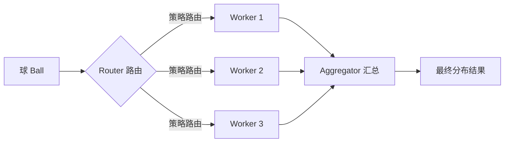

# 高尔顿板（Galton Board）MVP 原型

> 功能域：`galton` ｜ 版本：`v0.1 (init)` ｜ 关联 Issue：#43

---

## 背景

高尔顿板是英国科学家弗朗西斯·高尔顿发明的演示装置：小球从顶端落下，经过一系列钉子时随机偏向左或右，最终落在底部各槽位，形成近似正态分布的图案。

本模块把这一物理原理映射为**软件流水线**，搭建**单层 Router + 3 Worker + 1 Aggregator** 最小原型，验证「球路由 → 加工 → 合并」闭环。

## 物理对照

| 高尔顿板物理概念 | 软件映射 | 说明 |
|----------------|----------|------|
| 球（Ball） | 输入任务数据项 | 待处理的数据项 |
| 钉子（Peg） | Router（路由派发器） | 将球按策略路由到 3 个 Worker 之一 |
| 路径（Path） | Worker（处理器 ×3） | 对球做「加工」（标记/统计/变换） |
| 槽位（Slot） | Aggregator（汇总合并器） | 收集全部 Worker 产出，合并成最终分布 |

## 架构拓扑



## 模块清单

| 文件 | 职责 | 输入 | 输出 |
|------|------|------|------|
| `galton/engine.sh` | Bash 核心引擎（Router + Worker + Aggregator） | 策略 + 数据项列表 | 加工结果 + 分布统计 |
| `galton/engine.py` | Python 等价实现（云 CI / 真实环境） | 策略 + 数据项列表 | 汇总结果 dict |
| `galton/__init__.py` | 模块接口导出 | - | - |
| `tests/test_galton.sh` | 自测信号灯 | - | PASS/FAIL |
| `docs/GALTON.md` | 本设计文档 | - | - |

## 路由策略

| 策略 | 原理 | 适用场景 |
|------|------|---------|
| `round-robin` | 轮询：依次分配到 worker1→2→3→1→... | 负载均衡、均匀分布验证 |
| `hash` | 字符串哈希取模 | 稳定路由（同一任务始终到同一 worker） |
| `random` | 随机分配 | 模拟高尔顿板随机性、近似分布观察 |

## 使用方式

```bash
# 跑完整闭环（round-robin 路由）
bash local-agent/galton/engine.sh run round-robin "task-a" "task-b" "task-c"

# 跑完整闭环（hash 路由）
bash local-agent/galton/engine.sh run hash "apple" "banana" "cherry"

# 演示
bash local-agent/galton/engine.sh demo

# 单命令
bash local-agent/galton/engine.sh route round-robin "task" 0   # → 1
bash local-agent/galton/engine.sh worker 2 "hello"             # → [W2@...]hello
bash local-agent/galton/engine.sh aggregate                    # → 汇总分布

# Python 接口
python3 -c "
import sys; sys.path.insert(0, 'local-agent')
from galton import run_galton
print(run_galton(['a','b','c'], 'round-robin'))
"
```

## 自测

```bash
bash local-agent/tests/test_galton.sh
```

测试项：

| # | 验证内容 | 环境 |
|---|---------|------|
| T-01 | Router 轮询路由正确（1→2→3→1→...） | 沙盒 ✅ |
| T-02 | Worker 加工打标正确 | 沙盒 ✅ |
| T-03 | Aggregator 汇总统计正确 | 沙盒 ✅ |
| T-04 | 完整闭环运行成功（6 球均匀分布） | 沙盒 ✅ |
| T-05 | 非法路由策略正确报错 | 沙盒 ✅ |
| T-06 | worker_id 越界正确报错 | 需 python3 |
| T-07 | hash 策略 11 球全部处理 | 沙盒 ✅ |
| T-08 | Python 接口全部断言通过 | 需 python3 |

## 设计要点

1. **最小原型**：单层 Router + 3 Worker + 1 Aggregator，仅验证闭环，不做复杂调度。
2. **双实现**：Bash 版（沙盒可直接验证）+ Python 版（云 CI / 真实环境）。
3. **解耦**：Router 只管路由（策略可切换），Worker 只管加工（标记逻辑独立），Aggregator 只管汇总（统计不依赖路由策略）。
4. **接口显式**：`__init__.py` 导出 5 个公开接口，跨模块可独立调用。

## 后续演进

- **V0.2**：多策略路由对比（同一批球用不同策略跑，对比分布差异）。
- **V0.3**：多层 Router（多级钉板，模拟深层分流）。
- **V0.4**：接入真实任务调度（将球映射为 agent 任务，Router 映射为经理分配）。
