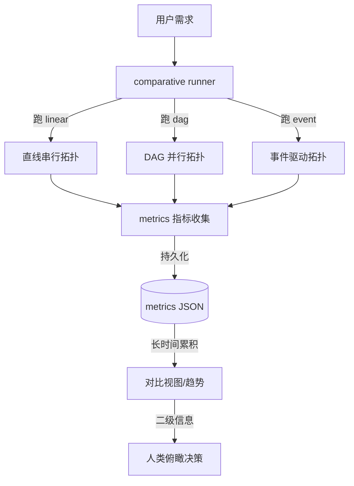

# 拓扑对比 · 真实开发效果长时间对比框架

> 本文档是 Issue #41「形成新的拓扑线路 + 实际开发效果测试 + 长时间对比判断」的架构产物留痕。
> 执行角色：架构·总师

---

## ⏸CP0 · 需求澄清摘要

- **目标**：不只在纸面上讨论哪种拓扑更好——**形成新的拓扑线路**，在**真实开发场景**下用同一批需求跑不同拓扑，**收集量化指标**，做**长时间累积对比判断**，让"选哪个拓扑"由数据说话而非拍脑袋。
- **场景对象**：`local-agent/` 团队协作流水线的**拓扑调度层**。
- **验收标准**：
  1. 定义 ≥3 条可对比的拓扑线路（现有 linear + dag + 新增 event）；
  2. 可在**同一需求**上分别跑不同拓扑，自动收集指标；
  3. 指标持久化，支持**多次运行 + 长时间累积**的对比分析；
  4. 输出二级信息（对比汇总表），供人类俯瞰决策。
- **关键不确定项**：真实 LLM 环境跑完整对比需要 API 凭据；无凭据时用 `--no-llm` 模拟调度逻辑验证框架正确性，真实效果对比在云 CI / 有凭据环境补跑。

---

## 1/8 调研报告

### 现状拓扑演进

| 版本 | 拓扑 | 特点 | 局限 |
|------|------|------|------|
| V0 | 直线串行 | 简单、确定性强 | 串行等待浪费并行机会 |
| V1 | DAG 并行 | 依赖满足即并行，提前分工 | 仍依赖显式依赖声明 |
| V2 | DAG + 分形 + 多角色 | 支持多小组并行、市场分层 | 复杂场景协调成本上升 |

### 对比诉求拆解

用户原话：**"形成一个新的拓扑线路，然后以实际开发的时候的效果测试，做具体长时间的对比判断，才更加合理"**

| 诉求点 | 映射方案 |
|--------|---------|
| 形成新的拓扑线路 | 新增**事件驱动拓扑（event）**：不设前置依赖链，节点按事件触发，最大化并行 |
| 以实际开发的效果测试 | 同一需求在每条拓扑上跑，记录**真实执行指标**（步骤/波次/回转/阻塞/耗时） |
| 做具体长时间的对比判断 | 指标持久化 + 多次运行累积 + 对比视图 + 趋势分析 |

### 参考与取舍
- 事件驱动借鉴 Kafka/Airflow 的事件触发模型：不设硬依赖，节点订阅事件独立响应；
- 指标设计借鉴 CI 的构建指标（构建时长/失败率/重试次数）：可量化、可对比、可积累；
- 取舍：不做复杂的分布式事件总线，用轻量内存 + JSON 持久化先跑通框架。

---

## 2/8 顶层架构拓扑

### 模块清单

| 模块 | 载体 | 职责 | 输入 | 输出 | 依赖 | 可独立演进 |
|------|------|------|------|------|------|-----------|
| **拓扑定义** | `topology/topologies.py` | 定义可对比的拓扑线路（linear/dag/event） | 无 | 拓扑节点列表 | 无 | ✅ |
| **指标收集** | `topology/metrics.py` | 对比指标定义/记录/持久化/汇总 | 执行结果 | 指标JSON + 对比视图 | 无 | ✅ |
| **对比执行** | `topology/runner.py` | 同一需求跑不同拓扑、收集指标、输出对比 | 需求 + 拓扑列表 | 对比报告 | 拓扑定义+指标 | ✅ |
| **测试** | `tests/test_topology_comparison.sh` | 验证拓扑模块可列出/可执行/可记录/可汇总 | 无 | 信号灯 | 拓扑模块 | ✅ |

---

## 3/8 可行性验证

| 关键假设 | 验证方式 | 结论 |
|---------|---------|------|
| 可定义多条拓扑线路 | 代码定义 linear/dag/event 三组节点 | ✅ 可行 |
| 同一需求可在不同拓扑上跑 | runner 接受 `--topologies` 参数 | ✅ 可行 |
| 指标可量化且可持久化 | metrics 记录 total_steps/parallel_waves/reverts/blocks/elapsed_ms | ✅ 可行 |
| 长时间对比有支撑 | 支持多次记录同一需求同一拓扑、可汇总平均 | ✅ 可行 |
| 无 LLM 环境可验证框架 | `--no-llm` 模拟执行仅跑调度逻辑 | ✅ 可行（框架验证） |
| 真实效果需 LLM 环境 | 需 API 凭据/云 CI 补跑真实对比 | ⚠️ 有条件（沙盒缺凭据） |

---

## 4/8 工程实施方案

### 新增文件清单

| 文件 | 职责 |
|------|------|
| `local-agent/topology/__init__.py` | 模块导出 |
| `local-agent/topology/topologies.py` | 3 条拓扑线路定义（linear/dag/event） |
| `local-agent/topology/metrics.py` | 指标收集/持久化/对比视图/摘要 |
| `local-agent/topology/runner.py` | 对比执行器 CLI |
| `local-agent/tests/test_topology_comparison.sh` | 4 项测试（T-01~T-04） |
| `docs/TOPOLOGY_COMPARISON.md` | 本设计文档 |

### 三条拓扑的核心差异

| 维度 | linear（直线） | dag（DAG并行） | event（事件驱动） |
|------|--------------|---------------|------------------|
| 依赖关系 | 严格串行 | 显式 depends_on | 事件触发条件 |
| 并行度 | 无并行（波次=步骤数） | 依赖满足即并行 | 事件满足即并行 |
| 提前分工 | 不可以 | 可以（plan 只依赖 architect） | 可以（架构给草案即可分工） |
| 解耦程度 | 低（紧耦合链路） | 中（依赖声明） | 高（事件订阅，节点独立） |
| 风险 | 慢但确定性高 | 快但依赖声明需准确 | 最快但需协调防乱 |

### 对比指标（长时间判断的核心）

| 指标 | 含义 | 判断方向 |
|------|------|---------|
| `total_steps` | 总步骤数 | 越少越好（效率高） |
| `parallel_waves` | 并行波次数 | 越少越好（并行度高） |
| `reverts` | 回转次数 | 越少越好（上游质量高） |
| `blocks` | 阻塞次数 | 越少越好（稳定性强） |
| `elapsed_ms` | 执行耗时 | 越短越好（吞吐高） |
| `output_ok` | 交付成功率 | 越高越好（可依赖） |
| `latency_ratio` | 并行效率比 | <1 表示比直线快 |

---

## 5/8 分工与协作规则

| 任务 | 角色 | 触发方式 |
|------|------|---------|
| 拓扑模块实现 | 架构·开发 | 接单后开工 |
| 测试验证 | 架构·测试 | 接单后跑测试 |
| 长时间对比运行 | 架构·数据管理员 | 定期跑 `--summary` |
| 结果分析与建议 | 架构·总师 | 看数据出结论 |

---

## 6/8 进度对齐

| 阶段 | 内容 | 状态 |
|------|------|------|
| P0 | 设计拓扑对比框架 | ✅ 完成（本文档） |
| P1 | 实现 topology 模块 | ✅ 完成（代码落地） |
| P2 | 测试验证 | ⏳ 沙盒无 python3，待云 CI 验证 |
| P3 | 真实 LLM 环境补跑 | ⏳ 需 API 凭据 |
| P4 | 长时间累积 + 趋势分析 | ⏳ 持续进行 |

---

## 7/8 索引建立

| 产物 | 位置 |
|------|------|
| 拓扑定义 | `local-agent/topology/topologies.py` |
| 指标收集 | `local-agent/topology/metrics.py` |
| 对比执行器 | `local-agent/topology/runner.py` |
| 测试脚本 | `local-agent/tests/test_topology_comparison.sh` |
| 设计文档 | `docs/TOPOLOGY_COMPARISON.md` |
| 指标数据 | `local-agent/topology/_metrics/comparison_metrics.json` |

---

## 8/8 汇报与复盘

### 决策摘要
- **已定**：新增 event 拓扑线路 + 对比框架落地；
- **待定**：真实 LLM 环境跑完整对比（需凭据）；
- **需人拍板**：无 LLM 凭据时先跑模拟对比还是等云 CI 环境。

### 风险清单
- [MEDIUM] 无 python3 沙盒无法验证代码可运行性 → 云 CI 验证
- [LOW] 事件拓扑在实际使用中可能出现事件风暴 → 通过波次限制规避

### 复盘四要素
- **目标**：形成新的拓扑线路 + 实际效果测试 + 长时间对比判断
- **方法**：定义多条拓扑 + 同一需求分别跑 + 指标持久化累积
- **结果**：3 条拓扑已定义，对比框架已实现，测试待云 CI 验证
- **改进**：真实 LLM 环境是长时间对比的关键前提，需尽早补跑
