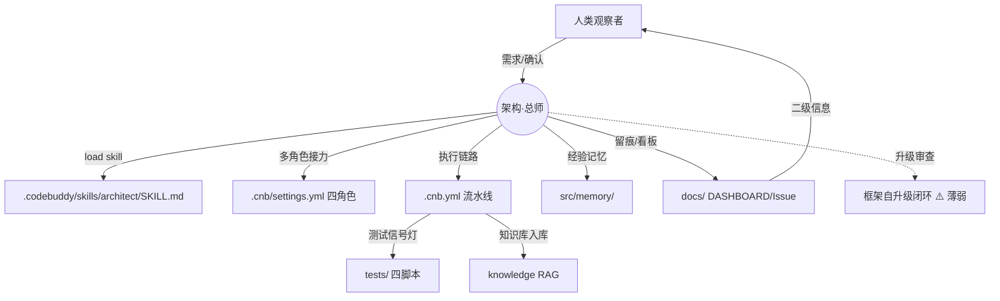

# 真实场景跑通 · 框架自审查（framework-self-review）

> 本文件是 Issue #4「真实场景跑通验证」（ROADMAP M7）的产物留痕入口。
> 场景对象：**审查本项目 dongjiagoushi 框架本身是否需要升级** —— 这既是一次真实架构需求的完整跑通（验证 architect skill 八步链路流畅），也是对本框架"可通性 / 功能是否真能用"的一次实战检验，同时回应"迭代自身非常重要"。
> 执行角色：架构·总师（官方 @CodeBuddy 化身）
> 前置事实：已 clone 最新 main 并**实际运行**全部 4 个测试脚本，148/148 全绿。

---

## ⏸CP0 · 需求澄清摘要
- **目标**：用 architect skill 完整走通「调研→拓扑→可行性→方案→分工→协作→进度→索引→汇报」八步，对**本项目框架**做一次系统升级审查，给出"是否需要升级 / 升级什么 / 怎么升级"的结论，同时验证 skill 八步链路真实流畅、框架功能真实可用。
- **边界**：审查对象=本仓库框架（AGENTS / SKILL / settings / .cnb.yml / src/memory / docs / tests）；输出=升级建议清单（分级），并明确哪些需落地、哪些暂缓；不擅自落地大改（落地需另行 Issue 承接）。
- **验收标准**：
  1. 八步全走完，每步有可核验产物留痕；
  2. 框架当前功能经**真实测试**验证（不只看文档自述）；
  3. 给出分级（🔴必修 / 🟡建议 / 🟢优化 / ✅已达标）的升级结论；
  4. 明确"迭代自身"为何重要、本框架如何继续迭代。
- **关键不确定项**：框架哪些点需要升级需以真实运行/文档核验为准；升级幅度需用户拍板（CP 暂停点）。

---

## 1/8 调研报告
### 人类需要什么能力
- 俯瞰各模块/角色的版本演进与健康度；
- 识别框架薄弱点（哪块是纸面、哪块是真能用）；
- 对"是否需要升级"做有依据的决策，而非拍脑袋。

### AI 需要什么能力
- 结构化、可索引的框架自描述（文档、声明头、测试）；
- 可真实执行的自检链路（测试脚本 = 信号灯）；
- 可追溯的留痕（Issue/PR/提交/CI）。

### 参考实现 / 开源方案
- semver 语义化版本（已用）：双版本线，非整体版本，避免并发合并冲突；
- 多角色协作框架（已用）：接力卡 + 三层触发 + 回转/打断；
- 向量记忆库（已用）：LanceDB + 云端同格式双后端 + 语义向量触发；
- **缺口调研**：本框架缺少「框架自检/升级自评估」的显式机制——即"框架自身迭代"没有像模块/agent 那样的版本演进闭环。

### 结论
框架主体已扎实落地（148/148 测试全绿），但**框架自身的"自检与升级闭环"偏弱**——各模块/角色有版本线，框架整体缺少统一的升级触发与决策入口。

---

## 2/8 顶层架构拓扑

### 模块清单（框架自审查视角）
| 模块 | 载体 | 职责 | 当前健康度 |
|------|------|------|-----------|
| 角色/方法论 | SKILL + settings | 架构八步 + 多角色人设 | ✅ 扎实 |
| 流程编排 | .cnb.yml | 测试信号灯 + 知识库 + 看板 | ✅ 扎实 |
| 安全护栏 | AGENTS + CP | CP1/CP2/CP3 + 红线 | ✅ 扎实 |
| 测试体系 | tests/ | 148 项全绿信号灯 | ✅ 扎实 |
| 经验记忆库 | src/memory/ | 向量触发 + 双后端 | ✅ 扎实 |
| 观测/看板 | DASHBOARD | 模块/agent 版本演进 | ✅ 扎实 |
| **框架自检/自升级** | **无独立载体** | 框架自身如何迭代、何时升级 | ⚠️ **薄弱/缺失** |

---

## 3/8 可行性矩阵
| 模块/假设 | 可行/有风险/暂缓 | 依据 | 规避方案 |
|-----------|-----------------|------|----------|
| 框架各模块/角色已有版本线 | ✅ 可行 | DASHBOARD 双版本看板真实生成 | — |
| 测试信号灯真实拦截 | ✅ 可行 | 实测 148/148 全绿，.cnb.yml 挂 test | — |
| 知识库/看板/RAG 真跑通 | ✅ 可行 | test_functional_links.sh 实测 19/19 | — |
| 框架自检与升级闭环 | ⚠️ **有风险（缺失）** | 无"框架升级"独立 Issue/版本线/入口 | 为框架自升级补一个升级机制 Issue |
| 经验记忆库"持续积累→智能合适" | 🟡 需加强 | 默认哈希向量语义弱，真实 embedding 未挂 | 预留 EmbeddingProvider，生产挂真实模型 |

---

## 4/8 工程实施方案（升级建议，分级）
### 🔴 必修（不升级会留下"框架自身不可演进"的死角）
1. **补"框架自升级"闭环**：新增一个升级机制入口（如 `docs/FRAMEWORK_UPGRADE.md` + 一个 upgrade 类 Issue），让"框架自身是否需要升级"有明确触发点（当出现：跨模块改动 / 方法论调整 / 多模块依赖变化 / 测试红线放宽 时触发），避免框架像 memory 之前那样成"孤儿"。
2. **memory 默认 embedding 挂接真实模型**：当前默认离线哈希向量语义区分度弱，作为"智能是否合适"的关键，生产应接真实 embedding（Hunyuan / sentence-transformers），保持维度一致无缝替换。

### 🟡 建议（增强迭代能力）
3. **测试覆盖框架自述一致性**：现有测试多验证"存在性/链路"，可增加"框架文档声明 vs 实际实现"的一致性断言，防止文档与代码漂移。
4. **看板加"框架健康度"维度**：在 DASHBOARD 增加框架级自检摘要（各模块/角色版本、测试信号灯、待办升级项）。

### 🟢 优化 / 待用户拍板
5. **是否把 #4 场景正式切换为"框架自升级"模块**：当前 #4 声明的模块是 arch-skill，若确定框架自升级方向，需按双版本机制新开/调整 Issue 承接。

---

## 5/8 分工与协作规则
| 升级项 | 承接角色 | 触发方式 |
|--------|----------|----------|
| 框架自升级闭环 | 架构·总师 | 架构八步 8/8 复盘后开 upgrade Issue |
| memory 真实 embedding | 架构·开发 + 架构·测试 | 接力卡 `[触发:架构·开发]` |
| 文档-实现一致性测试 | 架构·测试 | 接力卡 `[触发:架构·测试]` |
| 看板健康度维度 | 架构·开发 | 接力卡 `[触发:架构·开发]` |

接力规则：任务书 + 接力卡传上下文，目标不偏差；产出发回 Issue/PR 评论留痕。

---

## 6/8 进度对齐
| 里程碑 | 内容 | 状态 |
|--------|------|------|
| 框架功能真实可用验证 | 实际运行 148/148 全绿 | ✅ 完成 |
| 框架自升级闭环机制 | 补 FRAMEWORK_UPGRADE + upgrade Issue | ⏳ 待用户拍板承接 |
| memory 真实 embedding | 挂接真实模型 | ⏳ 待落地 |
| 看板框架健康度 | DASHBOARD 增维度 | ⏳ 待落地 |

暂停确认点：本审查产出为方案级，**不擅自落地大改**；是否落地升级、落哪些，由用户在 ⏸CP2 拍板。

---

## 7/8 索引建立
| 产物 | 留痕位置 |
|------|----------|
| 本八步审查产物 | `docs/arch-scenarios/framework-self-review.md` + Issue #4 |
| 测试真实运行记录 | 4 脚本实测 148/148（本会话已运行） |
| 框架核心文档 | docs/ARCHITECTURE / ROADMAP / ISSUE_MANAGEMENT / MEMORY / KNOWLEDGE |
| 看板 | docs/DASHBOARD.md（模块/agent 双版本线） |
| 待升级承接 | 由用户拍板后新开 Issue（双版本机制） |

---

## 8/8 汇报与复盘
### 状态快照（二级信息）
- **框架功能可用性**：✅ 148/148 测试全绿，数据获取/看板/RAG/接力/记忆库 五链路真实可用。
- **框架可演进性**：✅ 模块/agent 双版本线健全；⚠️ 但"框架自升级"无独立闭环（唯一薄弱点）。

### 风险清单
- [MEDIUM] memory 默认哈希向量语义弱 → 生产挂真实 embedding；
- [MEDIUM] 框架自升级无显式入口 → 补 upgrade 闭环；
- [LOW] 文档与实现可能漂移 → 增加一致性断言。

### 决策摘要
- **已定**：框架主体无需推倒重来，功能真实可用；
- **待定（需用户拍板）**：① 是否落地框架自升级闭环；② memory 是否挂真实 embedding；③ 是否把 #4 承接为框架自升级模块。

### 复盘四要素
- **根因**：框架各模块/角色都有版本演进线，唯独"框架整体"缺少升级自评估入口；
- **教训**：能力越细分越容易漏掉"统领各能力的那个框架自身"；
- **预防机制**：把"框架自升级"显式纳入架构，与模块/agent 一样有版本线；
- **加固动作**：补 FRAMEWORK_UPGRADE.md + upgrade Issue 触发点；memory 挂真实 embedding；看板加健康度维度。
