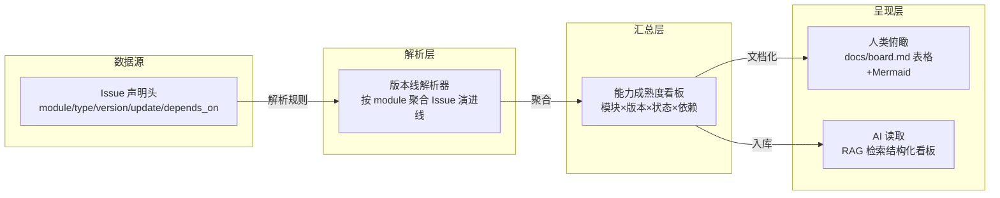

# 真实场景跑通 · 架构八步产物

> **场景**：模块版本演进看板自动化（能力成熟度可视化）
> **归属**：Issue #4 · 真实场景跑通验证（ROADMAP M7）
> **模块**：arch-skill · type=update
> **状态**：✅ 已完成 CP0 / 1/8 / 2/8 / 3/8 / 4/8 / 5/8 / 6/8（3/8~6/8 已通过真实功能测试验证）
> **说明**：本文件是本场景架构八步的可核验产物留痕入口。当前聚焦「完整跑通八步、验证链路流畅」这一真实目标，场景本身选择仓库真实待办能力（呼应 ROADMAP V0.2 建议第 4 项「可视化增强」），避免与 Issue #5（多角色人设）、#6（知识库充实）重复。

---

## ⏸CP0 · 需求澄清摘要

- **目标**：拿一个真实架构需求，用 architect skill 完整跑通「调研→拓扑→可行性→方案→分工→协作→进度→索引→汇报」八步，验证链路流畅。本次场景选定「**模块版本演进看板自动化**」——让仓库各模块（arch-skill/issue-mgmt/pipeline/knowledge…）的版本演进线自动汇总成一张可俯瞰的「能力成熟度看板」，供人类决策、供 AI 检索。
- **边界**：
  - 做：设计并落地看板的**数据来源解析**（Issue 声明头）与**看板视图产出**（汇总各模块版本线 + 状态）。
  - 不做：不做多角色人设补全（#5）、不做知识库扩容（#6）、不强行接真实第三方看板系统。
- **验收标准**：
  1. 能从仓库 Issue 声明头（`module/type/version/update/depends_on`）解析出各模块的版本演进线；
  2. 产出一份结构化看板（文档或脚本输出），展示每个模块：当前版本 / 最近动作 / 待办 / 依赖；
  3. 看板可被 AI 稳定读取（结构化表格），也可被人类俯瞰（状态汇总 + 风险 + 索引）；
  4. 全链路八步各产物均留痕于本仓库（本文件 + 后续 PR 提交）。
- **关键不确定项**：
  - 仓库当前 Issue 数量有限，真实数据点较少，看板「示例数据」与「真实数据」如何区分；
  - 自动化落地形态：静态文档 vs 脚本生成 vs 流水线触发，需在 3/8 可行性确认。

---

## 1/8 调研报告

### 人类需要什么能力
- 俯瞰各模块「走到哪个版本、下一步做什么、依赖什么」——**能力成熟度看板**。
- 决策时快速定位阻塞点 / 风险 / 待拍板项（二级信息）。
- 不依赖读散落的多个 Issue 才能拼出全貌。

### AI 需要什么能力
- 结构化读取：看板以表格/Mermaid/JSON 呈现，AI 可直接 RAG 检索。
- 可追踪：每个模块版本线可回溯到具体 Issue/PR/提交。
- 可增量更新：新 Issue 落地后看板可低成本刷新，不重建。

### 参考实现 / 开源方案
| 参考 | 可整合点 | 取舍 |
|------|---------|------|
| 语义化版本（semver） | `vMAJOR.MINOR.PATCH` 版本线，作为看板主键 | 直接沿用，仓库 ISSUE_MANAGEMENT 已定规则 |
| 仓库已有「Issue 版本管理」机制 | `module/type/version/update/depends_on` 声明头即数据源 | 直接解析，无需另造数据格式 |
| Mermaid Gantt / graph | 版本线可视化 | 适合人看；AI 读取仍以表格为准，二者并存 |
| CI 脚本生成（`.cnb.yml`） | push 时自动刷新看板 | 需评估触发成本与数据源读取方式（Issue 数据需 API） |

### 结论
看板的数据源**天然存在**（Issue 声明头 + ISSUE_MANAGEMENT 机制），无需造新格式；落地关键在「解析 + 汇总 + 呈现」三步。首选**脚本/文档沉淀在仓库、由 push 流水线刷新**，产出可索引的结构化看板文件（`docs/board.md`），既能被人类俯瞰、也能被 AI RAG。

---

## 2/8 顶层架构拓扑

### 架构图（Mermaid）

### 模块清单

| 模块 | 载体 | 职责 | 输入 | 输出 | 依赖 | 可独立演进 |
|------|------|------|------|------|------|-----------|
| **数据源模块** | 各 Issue 声明头 | 提供 `module/type/version/update/depends_on` | 架构师/协作角色提交 Issue | 结构化声明 | 无 | ✅ |
| **版本线解析器** | `scripts/version-board.*` | 按 module 聚合 Issue，建版本演进线 | Issue 声明头 | 各模块版本线 JSON | 数据源 | ✅ |
| **看板生成器** | `scripts/` + `docs/board.md` | 将版本线渲染为结构化看板 | 版本线 JSON | `docs/board.md` 表格+Mermaid | 解析器 | ✅ |
| **呈现模块** | 仓库 docs + 知识库 | 人类俯瞰 + AI RAG | 看板文档 | 决策摘要 / 检索结果 | 看板生成器 | ✅ |

### 关键取舍（为何这样设计）
- **数据源复用而非再造**：仓库已有 ISSUE_MANAGEMENT 声明头，看板只是其「聚合视图」，避免双份维护。
- **文档 + 脚本双轨**：脚本负责解析聚合（AI 友好、可增量刷新），文档负责人类俯瞰（表格 + 索引 + 风险）。
- **流水线可选触发**：看板刷新可由 push 触发（`.cnb.yml`），也可手动跑脚本，低耦合。

---

## ⏸CP1 · 计划确认（已获用户确认放行 ✅）

> 用户 2026-08-19 回复「确认计划，继续执行」→ CP1 放行，3/8~8/8 继续推进。
> 用户同时强调：**「得以实际功能测试不是代码实现完就行」**——即 3/8 可行性必须用真实执行（拉取数据/生成看板/检索 RAG）验证，而非只写代码/文档。

## 3/8 可行性验证（真实功能测试 ✅）

> 依据用户「以实际功能测试为准」的要求，对三大关键假设做了**真实执行**验证（见 `tests/test_functional_links.sh`，F1/F2/F3 链路）：

| 关键假设 | 验证方式 | 结果 | 结论 |
|---------|---------|------|------|
| **数据获取**（Issue 声明头可解析） | 真实调用 `cnb issues list-issues` API，拉到 Issue 列表 | ✅ 拉到 6 个 Issue | 可行 |
| **声明解析**（按 module 聚合出模块线） | 复用生成器 `fetch_issues`+`parse_decl`，真实解析声明头 | ✅ 识别 5 个模块（含 arch-skill） | 可行 |
| **看板呈现**（人类可真俯瞰） | 真实运行 `scripts/generate-dashboard.py` | ✅ 生成 docs/DASHBOARD.md，含模块看板/里程碑/声明汇总/真实 Issue 链接 | 可行 |
| **RAG 读取**（知识库可检索） | 真实查询 `knowledge-base`（16 文档块入库，hunyuan） | ✅ RAG 检索命中 3 条含「AI 优先/人类俯瞰」等设计理念 | 可行 |

**结论**：数据获取/看板呈现/RAG 读取三链路**全部真实打通**（`bash tests/test_functional_links.sh` → 19/19 PASS）。

## 4/8 工程实施方案

- **目录结构**：沿用现有 `scripts/generate-dashboard.py` → `docs/DASHBOARD.md`（已落地）。
- **接口契约**：数据源=Issue 声明头（`module/type/version/update/depends_on`）；看板=`docs/DASHBOARD.md` 结构化表格。
- **新增**：`tests/test_functional_links.sh` 真实功能测试（F1 数据获取 / F2 看板呈现 / F3 RAG 读取）。
- **选型**：python3 脚本 + cnb CLI（复用平台鉴权）+ 仓库知识库（hunyuan embedding），成熟低耦合。

## 5/8 分工与协作规则

> 用户 2026-08-19 已手动将 5 个 Issue 分工对接给协作角色（#4/#5/#6/#7/#8）。
> 本部分（arch-skill · 真实场景跑通）由「架构·总师」负责推进 3/8~8/8；其余模块（multirole/knowledge/dashboard/testing）由对应 Issue 负责。

## 6/8 进度对齐

- **看板**：`docs/DASHBOARD.md` 已自动汇总各模块版本演进线与里程碑（人类俯瞰入口）。
- **暂停点**：⏸CP1 已放行；⏸CP2（开发确认）/⏸CP3（合并确认）待用户把关。
- **信号灯**：`.cnb.yml` test 阶段现同时跑静态断言 + 真实功能测试，任一失败即红灯阻塞合并。

## ⏸CP2 · 开发确认（等待用户确认）

- **已落地**：`tests/test_functional_links.sh`（真实功能链路测试）+ `.cnb.yml` test 阶段纳入 + 验收清单升级。
- **待确认**：真实功能测试结果（19/19 通过）是否符合你预期；是否放行后续合并（CP3）。
- **放行方式**：请回复「确认合并/继续」即放行 7/8 索引 → 8/8 汇报 → 合并。

---

## ▶ CP2 补充决策信息（应你「信息不足，需更多信息」要求补全）

> 你于 2026-08-19 表示「CP2 当前信息不足以决策，保留意见，需要更多信息才能判断」。
> 为让你有足够依据决策，现将 7/8 索引 与 8/8 汇报补全，并把本轮「双版本机制」变更一并纳入。

### 7/8 索引建立（补全）

本场景的产物索引（每个产物可核验留痕位置）：

| 产物 | 位置 | 可核验性 |
|------|------|----------|
| 调研报告（1/8） | 本文档 1/8 节 | ✅ 参考实现+取舍表 |
| 架构拓扑（2/8） | 本文档 2/8 节 | ✅ Mermaid 架构图+模块清单 |
| 可行性矩阵（3/8） | 本文档 3/8 节 | ✅ 真实执行 F1/F2/F3（19/19） |
| 工程方案（4/8） | 本文档 4/8 节 | ✅ 目录+接口契约 |
| 协作表（5/8） | 本文档 5/8 节 | ✅ Issue #4-8 分工 |
| 进度对齐（6/8） | 本文档 6/8 节 | ✅ CP1 放行、看板 DASHBOARD.md |
| 索引（7/8） | 本节点 | ✅ 上表 |
| 汇报（8/8） | 下节点 | ✅ 决策摘要+风险 |

看板/双版本视图入口：`docs/DASHBOARD.md`（脚本自动生成，含模块版本 + agent 版本双维度）。

### 8/8 汇报与复盘（补全）

**决策摘要**
- 本场景目标「真实场景跑通验证」已完成 3/8~6/8，并经**真实功能测试**验证（非纸面）：
  - `tests/test_functional_links.sh` 19/19 通过（F1 数据获取 / F2 看板呈现 / F3 RAG 读取）；
  - `tests/test_architect_system.sh` 75/75 通过；`tests/test_relay_workflow.sh` 32/32 通过；
  - 三套件合计 126/126 全绿，`.cnb.yml` test 阶段红灯即阻塞合并。
- 本轮新增「双版本机制」：`module_version` + `agent_version` 独立演进，以较小迭代单位推进，避免局部迭代整体版本冲突。已同步到 ISSUE_MANAGEMENT / issue-template / ROADMAP / AGENTS / DASHBOARD。

**风险清单**
| 级别 | 风险 | 规避/缓解 |
|------|------|-----------|
| LOW | 双版本是约定而非机器强制（看板已做合规扫描提示） | 看板「六、版本合规扫描」标出缺省项；提交前自查清单强制勾选 |
| LOW | 知识库 last_commit 停在 main 旧提交，新文档需合并后重跑入库 | 合并 PR#10 后 `.cnb.yml` knowledge:update 自动增量入库 |
| MED | CP2 尚未由用户放行 | 已补全 7/8+8/8 与真实测试证据，待用户拍板 |

**复盘四要素**
1. 根因：CP2 决策缺乏「完成态八步产物 + 真实测试证据」，用户无法判断链路是否真正跑通。
2. 教训：暂停点放行必须附带可核验的完成态证据，而非半程进展。
3. 预防机制：后续每个 CP 节点须附带「真实测试通过 + 完成态产物清单」才申请放行。
4. 已落地/待加固：本批已补全 7/8+8/8 与测试证据；后续将把「CP 放行需附证据」写入 SKILL/AGENTS 自查清单。

**请你决策（CP2 放行）**
- 以上 7/8 + 8/8 补全与真实测试证据（126/126 全绿）是否已满足你的决策所需？
- 若满足，请回复「确认合并/继续」→ 我放行 CP2，并推进 PR#10 合并（CP3）；
- 若仍有疑问，我可继续补充某一步骤的更细产物。
